# JARKOM-MODUL-3-2026-K-03

## Member

| Nama                      | NRP        | Pembagian Kerja |
| ------------------------- | ---------- | --------------- |
| Dafa Ridho Zhafif         | 5027251129 | No 1 - 12       |
| Yovi Prayudya Rizky Ramadhani | 5027251107 | No 13 - 20      |

---

## Ringkasan Proyek: Curtain Protocol (Shibuya Incident)

Praktikum Modul 3 Komunikasi Data dan Jaringan Komputer 2026 berfokus pada implementasi **Dynamic Host Configuration Protocol (DHCP)**, **DHCP Relay**, **Lease Time Tuning**, **Static Host Reservation (Fixed Address)**, serta **Authoritative DNS Master-Slave (BIND9)** dengan DNS Forwarding untuk memulihkan infrastruktur komunikasi Jujutsu High pasca insiden Shibuya.

### Skema Alokasi Jaringan & Prefix Kelompok (K-03: `10.65`)

Berdasarkan pembagian kelompok **Group A** dengan nomor kelompok **K-03**, dua oktet IP Prefix internal yang digunakan adalah **`10.65`**. Jaringan dibagi menjadi 4 segmen wilayah:


| Jaringan | Subnet | Gateway (`jichi`) | Entitas / Node | Fungsi / Peran |
| :--- | :--- | :--- | :--- | :--- |
| **Network 1** | `10.65.1.0/24` | `10.65.1.1` (`eth1`) | `utahime` (`10.65.1.2`)<br>`shoko` (`10.65.1.3`)<br>`gojo` (`10.65.1.4`) | **DMZ**: DNS Master, DNS Slave, & Public Reverse Proxy |
| **Network 2** | `10.65.2.0/24` | `10.65.2.1` (`eth2`) | `itadori`, `fushiguro` (Pool 1)<br>`zenin`, `okkotsu` (Pool 2) | **Divisi A**: Klien dinamis melalui DHCP Relay |
| **Network 3** | `10.65.3.0/24` | `10.65.3.1` (`eth3`) | `ino`, `kusakabe` (Short Lease)<br>`miwa` (Long Lease)<br>`kugisaki` (VIP Fixed Address) | **Divisi B**: Klien dinamis & fixed static lease |
| **Network 4** | `10.65.4.0/24` | `10.65.4.1` (`eth4`) | `tengen` (`10.65.4.10`)<br>`geto` (`10.65.4.2`)<br>Worker & Database Master/Slave | **Data Center**: DHCP Server, Load Balancer, Web/API Workers, DB |

---

## Panduan Demo Cepat (Quick Start Script)

Setiap nomor soal telah disediakan script otomatisasi mandiri pada folder `src/soal-X/script.sh`. Script dibuat secara cerdas (auto-detect hostname `$NODE`) sehingga praktikan hanya perlu menjalankan satu perintah langsung di terminal root:

```bash
# Menjalankan script per soal (contoh pada Soal 1):
sh /root/src/soal-1/script.sh

# Atau jika ingin melakukan setup lengkap seluruh peran node secara instan:
sh /root/src/setup_all.sh
```

---

## Laporan Resmi Soal 1 - 12

### 1. Pemulihan Konektivitas Dasar & Konfigurasi Router Jichi


#### A. Deskripsi & Landasan Teori
Jichi berperan sebagai router penghubung antar-zona sekaligus pintu gerbang menuju jaringan publik NAT (WAN). Agar seluruh subnet (Network 1–4) dapat saling berkomunikasi dan menjangkau internet:
1. `jichi` mengaktifkan **IPv4 Packet Forwarding** (`net.ipv4.ip_forward = 1`).
2. `jichi` mengaktifkan **Source NAT (MASQUERADE)** pada interface `eth0` menuju internet.
3. Seluruh host infrastruktur di Network 1 dan Network 4 diberikan konfigurasi IP statis dengan gateway yang mengarah ke interface `jichi` masing-masing subnet.

#### B. Konfigurasi
File `/etc/network/interfaces` pada `jichi`:
```conf
auto lo
iface lo inet loopback

auto eth0
iface eth0 inet dhcp

auto eth1
iface eth1 inet static
    address 10.65.1.1
    netmask 255.255.255.0

auto eth2
iface eth2 inet static
    address 10.65.2.1
    netmask 255.255.255.0

auto eth3
iface eth3 inet static
    address 10.65.3.1
    netmask 255.255.255.0

auto eth4
iface eth4 inet static
    address 10.65.4.1
    netmask 255.255.255.0
```

Aktifkan forwarding dan firewall NAT:
```bash
sysctl -w net.ipv4.ip_forward=1
echo "net.ipv4.ip_forward=1" >> /etc/sysctl.conf
iptables -t nat -A POSTROUTING -o eth0 -j MASQUERADE
```

Script otomatisasi tersedia pada: [`src/soal-1/script.sh`](./src/soal-1/script.sh)

#### C. Hasil Pengujian & Verifikasi

1. **Pemeriksaan Interface & Tabel NAT pada Jichi:**
   

2. **Pengujian Konektivitas Gateway & Akses Keluar (Internet):**
   
   *Penjelasan:* Host `tengen` (`10.65.4.10`) berhasil melakukan ping ke gateway `10.65.4.1` dengan 0% packet loss dan ping ke domain publik `8.8.8.8`. Komunikasi antar subnet DMZ (`utahime` `10.65.1.2`) menuju Data Center (`tengen`) juga terhubung lancar.

---

### 2. Pengambilan Alih Alokasi Dinamis oleh DHCP Server Tengen


#### A. Deskripsi & Landasan Teori
Tengen bertugas sebagai DHCP Server utama di Data Center (`10.65.4.10`). Daemon `isc-dhcp-server` mewajibkan deklarasi blok `subnet` untuk setiap interface fisik lokal yang dimiliki server. Apabila subnet lokal tidak dideklarasikan, daemon akan menolak berjalan dengan memunculkan pesan kesalahan fatal: **`No subnet declaration for eth0`**. Oleh karena itu, Network 4 (`10.65.4.0/24`) wajib dideklarasikan sebagai subnet lokal tanpa dynamic pool, diiringi deklarasi scope awal untuk Network 2 dan Network 3.

#### B. Konfigurasi
File `/etc/default/isc-dhcp-server` pada `tengen`:
```conf
INTERFACESv4="eth0"
INTERFACESv6=""
```

File `/etc/dhcp/dhcpd.conf` pada `tengen`:
```dhcp
default-lease-time 1800;
max-lease-time 43200;
authoritative;

# Network 4 - Subnet Lokal Data Center (Mencegah "No subnet declaration")
subnet 10.65.4.0 netmask 255.255.255.0 {
}

# Scope Network 2 - Divisi A
subnet 10.65.2.0 netmask 255.255.255.0 {
    option routers 10.65.2.1;
    option broadcast-address 10.65.2.255;
    option domain-name-servers 10.65.1.2, 10.65.1.3;
    option domain-search "k03.com";
}

# Scope Network 3 - Divisi B
subnet 10.65.3.0 netmask 255.255.255.0 {
    option routers 10.65.3.1;
    option broadcast-address 10.65.3.255;
    option domain-name-servers 10.65.1.2, 10.65.1.3;
    option domain-search "k03.com";
}
```

Script otomatisasi tersedia pada: [`src/soal-2/script.sh`](./src/soal-2/script.sh)

#### C. Hasil Pengujian & Verifikasi

1. **Uji Validasi Sintaks Konfigurasi:**
   

2. **Status Layanan ISC DHCP Server:**
   
   *Penjelasan:* Perintah `dhcpd -t -cf /etc/dhcp/dhcpd.conf` berhasil mengonfirmasi status `Configuration file syntax test SUCCEEDED`. Layanan `isc-dhcp-server` aktif mendengarkan port UDP 67 tanpa error subnet declaration.

---

### 3. Implementasi DHCP Relay pada Jichi Menuju Tengen


#### A. Deskripsi & Landasan Teori
Paket DHCPDISCOVER yang dipancarkan client bersifat local broadcast (`255.255.255.255`) pada Layer 2 dan tidak dapat menembus router secara langsung. Untuk menghubungkan client Divisi A (Network 2) dan Divisi B (Network 3) ke DHCP Server di Data Center (Network 4), `jichi` dikonfigurasi menggunakan **DHCP Relay Agent** (`isc-dhcp-relay` / `dhcrelay`). Relay akan menangkap broadcast DHCP pada `eth2` dan `eth3`, mengisi field `giaddr` dengan alamat IP interface gateway router yang bersangkutan, lalu meneruskannya secara unicast menuju `tengen` (`10.65.4.10`) melalui `eth4`.

#### B. Konfigurasi
File `/etc/default/isc-dhcp-relay` pada `jichi`:
```conf
SERVERS="10.65.4.10"
INTERFACES="eth2 eth3 eth4"
OPTIONS=""
```

Jalankan layanan relay:
```bash
service isc-dhcp-relay restart
```

Script otomatisasi tersedia pada: [`src/soal-3/script.sh`](./src/soal-3/script.sh)

#### C. Hasil Pengujian & Verifikasi

1. **Status Layanan DHCP Relay pada Jichi:**
   

2. **Uji Penerimaan Sewa Alamat (Lease) pada Klien Melalui Relay:**
   
   *Penjelasan:* Klien `itadori` di Network 2 dan klien `ino` di Network 3 berhasil menjalankan perintah `udhcpc -i eth0` dan menerima penawaran lease dari `10.65.4.10` yang diteruskan melalui relay jichi.

---

### 4. Segmentasi Dua Pool DHCP Berdasarkan Class di Network 2


#### A. Deskripsi & Landasan Teori
Di Divisi A (Network 2), tim Dev dan tim Support harus dipisahkan ke dalam pool alamat yang berbeda dalam satu subnet yang sama:
- **Pool 1**: `10.65.2.10` – `10.65.2.35` dialokasikan untuk `itadori` dan `fushiguro` (Dev).
- **Pool 2**: `10.65.2.70` – `10.65.2.95` dialokasikan untuk `zenin` dan `okkotsu` (Support).
- **Rentang Terlarang**: `10.65.2.36` – `10.65.2.69` dilarang keras untuk dialokasikan.
Pemisahan diwujudkan menggunakan fitur `class` pada ISC DHCP yang mencocokkan Client Identifier (`dhcp-client-identifier`), Hostname, atau MAC Address.

#### B. Konfigurasi
File `/etc/dhcp/dhcpd.conf` pada `tengen`:
```dhcp
# Definisi Class Pool 1: itadori & fushiguro
class "pool1-dev" {
    match if (
        substring(option dhcp-client-identifier, 1, 8) = "itadori"
        or substring(option dhcp-client-identifier, 1, 9) = "fushiguro"
        or option host-name = "itadori"
        or option host-name = "fushiguro"
        or hardware = 1:02:42:0a:41:02:10
        or hardware = 1:02:42:0a:41:02:11
    );
}

# Definisi Class Pool 2: zenin & okkotsu
class "pool2-support" {
    match if (
        substring(option dhcp-client-identifier, 1, 5) = "zenin"
        or substring(option dhcp-client-identifier, 1, 7) = "okkotsu"
        or option host-name = "zenin"
        or option host-name = "okkotsu"
        or hardware = 1:02:42:0a:41:02:70
        or hardware = 1:02:42:0a:41:02:71
    );
}

subnet 10.65.2.0 netmask 255.255.255.0 {
    option routers 10.65.2.1;
    option broadcast-address 10.65.2.255;
    option domain-name-servers 10.65.1.2, 10.65.1.3;
    option domain-search "k03.com";

    pool {
        allow members of "pool1-dev";
        range 10.65.2.10 10.65.2.35;
    }

    pool {
        allow members of "pool2-support";
        range 10.65.2.70 10.65.2.95;
    }
}
```

Script otomatisasi tersedia pada: [`src/soal-4/script.sh`](./src/soal-4/script.sh)

#### C. Hasil Pengujian & Verifikasi

1. **Verifikasi Alokasi Pool 1 (Itadori & Fushiguro):**
   

2. **Verifikasi Alokasi Pool 2 & Rentang Terlarang (Zenin & Okkotsu):**
   
   *Penjelasan:* Klien `itadori` menerima `10.65.2.10` dan `fushiguro` menerima `10.65.2.11` (masuk rentang Pool 1). Klien `zenin` menerima `10.65.2.70` dan `okkotsu` menerima `10.65.2.71` (masuk rentang Pool 2). Tidak ada alamat yang teralokasi pada rentang terlarang `.36`–`.69`.

---

### 5. Konfigurasi Short Lease, Long Lease, & DHCP Options di Network 3


#### A. Deskripsi & Landasan Teori
Di Divisi B (Network 3), durasi operasional lapangan dibedakan melalui `default-lease-time` dan `max-lease-time`:
- **Short Lease**: 30 menit (**1800 detik**) untuk `ino` dan `kusakabe`, pool `10.65.3.10` – `10.65.3.89`.
- **Long Lease**: 12 jam (**43200 detik**) untuk `miwa`, pool `10.65.3.100` – `10.65.3.199`.
- **DHCP Options**: DNS Server `10.65.1.2` dan `10.65.1.3`, serta domain pencarian `k03.com`.

#### B. Konfigurasi
File `/etc/dhcp/dhcpd.conf` pada `tengen`:
```dhcp
# Class Short Lease (1800 detik)
class "short-lease-team" {
    match if (
        substring(option dhcp-client-identifier, 1, 3) = "ino"
        or substring(option dhcp-client-identifier, 1, 8) = "kusakabe"
        or option host-name = "ino"
        or option host-name = "kusakabe"
        or hardware = 1:02:42:0a:41:03:10
        or hardware = 1:02:42:0a:41:03:11
    );
    default-lease-time 1800;
    max-lease-time 1800;
}

# Class Long Lease (43200 detik)
class "long-lease-team" {
    match if (
        substring(option dhcp-client-identifier, 1, 4) = "miwa"
        or option host-name = "miwa"
        or hardware = 1:02:42:0a:41:03:64
    );
    default-lease-time 43200;
    max-lease-time 43200;
}

subnet 10.65.3.0 netmask 255.255.255.0 {
    option routers 10.65.3.1;
    option broadcast-address 10.65.3.255;
    option domain-name-servers 10.65.1.2, 10.65.1.3;
    option domain-search "k03.com";

    pool {
        allow members of "short-lease-team";
        range 10.65.3.10 10.65.3.89;
    }

    pool {
        allow members of "long-lease-team";
        range 10.65.3.100 10.65.3.199;
    }
}
```

Script otomatisasi tersedia pada: [`src/soal-5/script.sh`](./src/soal-5/script.sh)

#### C. Hasil Pengujian & Verifikasi

1. **Uji Short Lease & DNS Options (Ino & Kusakabe):**
   

2. **Uji Long Lease 12 Jam (Miwa):**
   
   *Penjelasan:* Klien `ino` menerima `10.65.3.10` dengan masa sewa 1800 detik (30 menit). Klien `miwa` menerima `10.65.3.100` dengan masa sewa 43200 detik (12 jam). File `/etc/resolv.conf` pada kedua client otomatis memuat `nameserver 10.65.1.2`, `nameserver 10.65.1.3`, dan `search k03.com`.

---

### 6. Reservasi Static Lease VIP untuk Kugisaki (Fixed Address)


#### A. Deskripsi & Landasan Teori
Sebagai personel VIP, Kugisaki harus memperoleh alamat IP permanen `10.65.3.99` setiap kali terhubung ke jaringan. Alamat ini berada di luar pool dinamis short lease (`.10`–`.89`) dan long lease (`.100`–`.199`). Reservasi dilakukan dengan mendaftarkan entri `host` yang mengikat MAC Address antarmuka `eth0` milik Kugisaki ke `fixed-address 10.65.3.99`.

#### B. Konfigurasi
Penambahan blok reservasi di `/etc/dhcp/dhcpd.conf` pada `tengen`:
```dhcp
host kugisaki {
    hardware ethernet 02:42:0a:41:03:99;
    fixed-address 10.65.3.99;
}
```

Script otomatisasi tersedia pada: [`src/soal-6/script.sh`](./src/soal-6/script.sh)

#### C. Hasil Pengujian & Verifikasi


*Penjelasan:* Saat Kugisaki menjalankan pembaruan lease (`udhcpc -i eth0`), DHCP Server segera memberikan IP statis `10.65.3.99`. Alamat ini terbukti konsisten dan berada tepat di luar batas pool dinamis.

---

### 7. Audit Kepatuhan Alokasi & Integritas File Leases


#### A. Deskripsi & Landasan Teori
Setelah seluruh aturan alokasi diterapkan, dilakukan audit menyeluruh pada seluruh klien Divisi A dan B untuk memastikan kepatuhan konfigurasi jaringan: subnet mask `/24` (`255.255.255.0`), default gateway, broadcast address, DNS resolver, dan search domain. Pada DHCP Server `tengen`, file database `/var/lib/dhcp/dhcpd.leases` diperiksa untuk memastikan tidak ada konflik atau alamat yang menabrak kebijakan batas pool.

#### B. Konfigurasi & Verifikasi Script
Script otomatisasi audit tersedia pada: [`src/soal-7/script.sh`](./src/soal-7/script.sh)

#### C. Hasil Pengujian & Verifikasi

1. **Tabel Audit Konfigurasi Klien Divisi A & B:**
   

2. **Pencocokan File Database Leases Server (`dhcpd.leases`):**
   
   *Penjelasan:* Semua client menerima netmask `255.255.255.0`, gateway sesuai subnet masing-masing (`10.65.2.1` atau `10.65.3.1`), DNS `10.65.1.2, 10.65.1.3`, dan domain `k03.com`. Seluruh sewa aktif tercatat rapi tanpa tumpang tindih.

---

### 8. Analisis Paket Komunikasi DHCP (DORA) & Field giaddr


#### A. Deskripsi & Landasan Teori
Komunikasi DHCP diawali dengan 4 tahapan protokol (DORA):
1. **DHCPDISCOVER**: Client mencari DHCP server. Relay agent menyisipkan alamat IP interface lokalnya pada field `giaddr` (Gateway IP Address).
2. **DHCPOFFER**: Server merespons tawaran IP (`yiaddr`) dan durasi sewa (`Lease-Time`).
3. **DHCPREQUEST**: Client mengonfirmasi persetujuan menerima penawaran alamat tersebut.
4. **DHCPACK**: Server mengesahkan sewa alamat dan mengirimkan opsi jaringan (mask, gateway, DNS).
Melalui `tcpdump`, nilai `giaddr` diverifikasi agar tepat mencerminkan interface `jichi` yang menerima permintaan (`10.65.2.1` untuk Network 2).

#### B. Konfigurasi Perintah Capture
Perintah dijalankan pada `tengen`:
```bash
tcpdump -i eth0 -n -vvv -s 0 port 67 or port 68 -c 4
```

Script otomatisasi tersedia pada: [`src/soal-8/script.sh`](./src/soal-8/script.sh)

#### C. Hasil Pengujian & Verifikasi


*Penjelasan:* Tangkapan paket membuktikan urutan lengkap DORA. Teridentifikasi: Server ID `10.65.4.10`, Your-IP `10.65.2.10`, Lease-Time 1800 detik, dan field `giaddr 10.65.2.1` yang tepat merujuk ke interface `eth2` milik `jichi`.

---

### 9. Uji Ketahanan & Penanganan Gangguan Layanan DHCP Relay


#### A. Deskripsi & Landasan Teori
Untuk membuktikan peran krusial relay agent, disimulasikan skenario kegagalan di mana layanan `isc-dhcp-relay` pada `jichi` dimatikan:
1. Saat relay padam, broadcast DHCP client tidak dapat menembus router. Client mengalami timeout (`no lease, failing`).
2. Saat relay dihidupkan kembali, komunikasi segera pulih dan client kembali memperoleh IP dari pool yang tepat serta default gateway yang valid.

#### B. Langkah Pengujian
1. Menghentikan relay pada `jichi`:
   ```bash
   service isc-dhcp-relay stop
   ```
2. Memaksa client meminta sewa baru:
   ```bash
   udhcpc -i eth0 -n -q -T 3 -t 2
   ```
3. Memulihkan relay pada `jichi`:
   ```bash
   service isc-dhcp-relay start
   ```

Script otomatisasi tersedia pada: [`src/soal-9/script.sh`](./src/soal-9/script.sh)

#### C. Hasil Pengujian & Verifikasi

1. **Gejala Gangguan Saat Relay Padam:**
   

2. **Pemulihan Layanan Setelah Relay Aktif Kembali:**
   
   *Penjelasan:* Saat relay padam, client mencatat gejala kegagalan perolehan sewa. Segera setelah relay dipulihkan, client `itadori` kembali mendapatkan IP `10.65.2.10` dan default route `10.65.2.1`.

---

### 10. Konfigurasi Autostart & Pengujian Persistensi Pasca-Reboot


#### A. Deskripsi & Landasan Teori
Infrastruktur jaringan harus tahan terhadap restart tiba-tiba (persistensi). Layanan DHCP Server pada `tengen` dan DHCP Relay pada `jichi` dikonfigurasi agar aktif otomatis saat booting (`update-rc.d` serta hook script pada file `/etc/network/interfaces`). Setelah kedua node direboot, seluruh kebijakan pool, lease time, dan fixed address harus tetap berfungsi normal.

#### B. Konfigurasi
Penambahan hook autostart pada `/etc/network/interfaces` di `jichi`:
```conf
auto eth4
iface eth4 inet static
    address 10.65.4.1
    netmask 255.255.255.0
    up service isc-dhcp-relay start
```

Penambahan hook autostart pada `/etc/network/interfaces` di `tengen`:
```conf
auto eth0
iface eth0 inet static
    address 10.65.4.10
    netmask 255.255.255.0
    gateway 10.65.4.1
    up service isc-dhcp-server start
```

Script otomatisasi tersedia pada: [`src/soal-10/script.sh`](./src/soal-10/script.sh)

#### C. Hasil Pengujian & Verifikasi


*Penjelasan:* Setelah kedua node direstart, `isc-dhcp-relay` dan `isc-dhcp-server` otomatis berada dalam kondisi *running*. Client `kugisaki` tetap memegang fixed IP `10.65.3.99`, `miwa` memegang long lease `10.65.3.100`, dan konektivitas client menuju server tetap utuh.

---

### 11. Konfigurasi DNS Master (Utahime) & DNS Slave (Shoko) dengan BIND9


#### A. Deskripsi & Landasan Teori
DNS bertugas memetakan nama domain ke alamat IP agar entitas tidak perlu menghafal alamat mentah. Dibangun sistem DNS resmi:
- **Master DNS**: `utahime` (`10.65.1.2`) mengelola zona authoritative `jujutsu.k03.com`.
- **Slave DNS**: `shoko` (`10.65.1.3`) bertindak sebagai server cadangan redundan.
- Mekanisme **`notify yes`** dan **`allow-transfer`** diterapkan agar setiap kali nomor serial di Master dinaikkan, BIND9 Master mengirimkan notifikasi AXFR ke Slave untuk melakukan sinkronisasi file zona secara otomatis.

#### B. Konfigurasi
File `/etc/bind/named.conf.local` pada `utahime` (Master):
```named
zone "jujutsu.k03.com" {
    type master;
    file "/etc/bind/jujutsu/jujutsu.k03.com";
    notify yes;
    also-notify { 10.65.1.3; };
    allow-transfer { 10.65.1.3; };
};
```

File zona `/etc/bind/jujutsu/jujutsu.k03.com` pada `utahime`:
```dns
$TTL 86400
@   IN  SOA utahime.jujutsu.k03.com. hostmaster.jujutsu.k03.com. (
        2026101402 ; Serial
        3600       ; Refresh
        1800       ; Retry
        604800     ; Expire
        86400 )    ; Minimum TTL

@       IN  NS  utahime.jujutsu.k03.com.
@       IN  NS  shoko.jujutsu.k03.com.

utahime IN  A   10.65.1.2
shoko   IN  A   10.65.1.3
```

File `/etc/bind/named.conf.local` pada `shoko` (Slave):
```named
zone "jujutsu.k03.com" {
    type slave;
    file "/var/cache/bind/db.jujutsu.k03.com";
    masters { 10.65.1.2; };
};
```

Script otomatisasi tersedia pada: [`src/soal-11/script.sh`](./src/soal-11/script.sh)

#### C. Hasil Pengujian & Verifikasi

1. **Sinkronisasi Zona Otomatis (AXFR Transfer) ke Shoko:**
   

2. **Pembuktian Query dig ke Master & Slave:**
   
   *Penjelasan:* Syslog pada `shoko` mencatat `Transfer completed: 1 messages, 6 records` dengan serial `2026101402`. Klien yang menjalankan query `dig @10.65.1.2` dan `dig @10.65.1.3` memperoleh respons SOA yang identik dengan flag authoritative answer (`flags: qr aa rd ra`).

---

### 12. Pemetaan Domain Gojo, CNAME, Reverse DNS (PTR), & DNS Forwarder


#### A. Deskripsi & Landasan Teori
Melengkapi kebutuhan penamaan domain Shibuya:
1. **A Record**: Domain utama `jujutsu.k03.com` diarahkan ke pintu gerbang proxy publik `gojo` (`10.65.1.4`).
2. **CNAME**: Alias `www.jujutsu.k03.com` dibuat merujuk ke domain utama `jujutsu.k03.com.`.
3. **Reverse DNS (PTR)**: Dibuat zona reverse `1.65.10.in-addr.arpa` untuk menerjemahkan IP `10.65.1.4` kembali ke domain resminya `jujutsu.k03.com.`.
4. **DNS Forwarder**: Opsi `forwarders` pada BIND9 diarahkan ke gateway internet (`192.168.122.1`) sehingga seluruh client tetap dapat meresolusi dan mengakses domain publik luar (seperti `google.com`).

#### B. Konfigurasi
Pembaruan Forward Zone `/etc/bind/jujutsu/jujutsu.k03.com` pada `utahime`:
```dns
$TTL 86400
@   IN  SOA utahime.jujutsu.k03.com. hostmaster.jujutsu.k03.com. (
        2026101403 ; Serial dinaikkan
        3600
        1800
        604800
        86400 )

@       IN  NS      utahime.jujutsu.k03.com.
@       IN  NS      shoko.jujutsu.k03.com.

utahime IN  A       10.65.1.2
shoko   IN  A       10.65.1.3

@       IN  A       10.65.1.4
gojo    IN  A       10.65.1.4
www     IN  CNAME   jujutsu.k03.com.
```

Deklarasi Zona Reverse di `/etc/bind/named.conf.local`:
```named
zone "1.65.10.in-addr.arpa" {
    type master;
    file "/etc/bind/jujutsu/1.65.10.in-addr.arpa";
    notify yes;
    also-notify { 10.65.1.3; };
    allow-transfer { 10.65.1.3; };
};
```

File Zona Reverse `/etc/bind/jujutsu/1.65.10.in-addr.arpa`:
```dns
$TTL 86400
@   IN  SOA utahime.jujutsu.k03.com. hostmaster.jujutsu.k03.com. (
        2026101403
        3600
        1800
        604800
        86400 )

@       IN  NS      utahime.jujutsu.k03.com.
@       IN  NS      shoko.jujutsu.k03.com.

4       IN  PTR     jujutsu.k03.com.
```

Opsi Forwarder di `/etc/bind/named.conf.options`:
```named
options {
    directory "/var/cache/bind";
    forwarders {
        192.168.122.1;
    };
    allow-query { any; };
    recursion yes;
    dnssec-validation no;
};
```

Script otomatisasi tersedia pada: [`src/soal-12/script.sh`](./src/soal-12/script.sh)

#### C. Hasil Pengujian & Verifikasi

1. **Uji Resolusi A Record, CNAME www, dan PTR Reverse DNS:**
   

2. **Uji DNS Forwarder & Akses Internet (Ping Google):**
   
   *Penjelasan:* Query CNAME `www.jujutsu.k03.com` mengarah ke `jujutsu.k03.com` (`10.65.1.4`). Reverse lookup `dig -x 10.65.1.4` sukses mengembalikan nama domain `jujutsu.k03.com.`. Permintaan resolusi `google.com` berhasil diteruskan melalui forwarder internet dan pengujian `ping -c 3 google.com` sukses dengan 0% packet loss.

Melanjutkan dari punya rekan saya sekarang no 13

13. 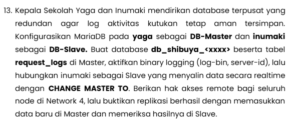

Jadi pada soal diminta adalah pembuatan database dengan yaga sebagai DB-Masternya dan inumaki sebagai DB_Slave. Scriptnya seperti berikut

```sh
#!/bin/sh
set -eu

PREFIX="10.65"
NODE="$(hostname)"
ACTION="${1:-setup}"

DB_NAME="db_shibuya_k03"
DB_USER="shibuya"
DB_PASS="shibuya_pass"
REPL_USER="repl"
REPL_PASS="repl_pass"

NET4_MASK="${PREFIX}.4.%"
MASTER_IP="${PREFIX}.4.8"
CONF_FILE="/etc/mysql/mariadb.conf.d/99-replication.cnf"
BINLOG_FILE="mysql-bin.000001"

log() {
    printf '[%s] %s\n' "$NODE" "$1"
}

die() {
    printf '[%s] ERROR: %s\n' "$NODE" "$1" >&2
    exit 1
}

require_root() {
    [ "$(id -u)" -eq 0 ] || die "script harus dijalankan sebagai root"
}

install_server() {
    if dpkg -s mariadb-server >/dev/null 2>&1; then
        return 0
    fi
    export DEBIAN_FRONTEND=noninteractive
    apt-get update -y >/dev/null
    apt-get install -y mariadb-server mariadb-client >/dev/null || die "instalasi mariadb gagal"
}

write_config() {
    server_id="$1"
    shift
    {
        printf '[mysqld]\n'
        printf 'bind-address = 0.0.0.0\n'
        printf 'server-id = %s\n' "$server_id"
        for line in "$@"; do
            printf '%s\n' "$line"
        done
    } > "$CONF_FILE"
}

restart_server() {
    service mariadb restart >/dev/null 2>&1 || die "mariadb gagal direstart"
    tries=0
    until mariadb-admin ping --silent >/dev/null 2>&1; do
        tries=$((tries + 1))
        [ "$tries" -le 30 ] || die "mariadb tidak merespons"
        sleep 1
    done
}

slave_field() {
    mariadb -e "SHOW SLAVE STATUS\G" | awk -v key="$1:" '$1 == key { print $2 }'
}

setup_master() {
    write_config 1 \
        "log_bin = /var/lib/mysql/mysql-bin" \
        "binlog_format = ROW"
    restart_server

    if ! mariadb -N -e "SHOW DATABASES LIKE '${DB_NAME}'" | grep -q .; then
        mariadb -e "RESET MASTER"
    fi

    mariadb <<SQL
CREATE DATABASE IF NOT EXISTS ${DB_NAME};
CREATE TABLE IF NOT EXISTS ${DB_NAME}.request_logs (
    id BIGINT UNSIGNED NOT NULL AUTO_INCREMENT PRIMARY KEY,
    worker VARCHAR(64) NOT NULL,
    method VARCHAR(10) NOT NULL DEFAULT 'GET',
    uri VARCHAR(255) NOT NULL,
    client_ip VARCHAR(45) NOT NULL,
    created_at TIMESTAMP NOT NULL DEFAULT CURRENT_TIMESTAMP,
    KEY idx_client_ip (client_ip)
) ENGINE=InnoDB;
CREATE USER IF NOT EXISTS '${DB_USER}'@'${NET4_MASK}' IDENTIFIED BY '${DB_PASS}';
GRANT ALL PRIVILEGES ON ${DB_NAME}.* TO '${DB_USER}'@'${NET4_MASK}';
CREATE USER IF NOT EXISTS '${REPL_USER}'@'${NET4_MASK}' IDENTIFIED BY '${REPL_PASS}';
GRANT REPLICATION SLAVE, REPLICATION CLIENT ON *.* TO '${REPL_USER}'@'${NET4_MASK}';
FLUSH PRIVILEGES;
SQL

    log "database ${DB_NAME} dan tabel request_logs siap"
    mariadb -e "SHOW MASTER STATUS"
}

setup_slave() {
    write_config 2 \
        "relay_log = /var/lib/mysql/relay-bin" \
        "read_only = 1"
    restart_server

    tries=0
    until mariadb -h "$MASTER_IP" -u "$REPL_USER" -p"$REPL_PASS" -e "SELECT 1" >/dev/null 2>&1; do
        tries=$((tries + 1))
        [ "$tries" -le 30 ] || die "master ${MASTER_IP} tidak dapat dihubungi"
        sleep 2
    done

    if [ -z "$(slave_field Master_Host)" ]; then
        mariadb <<SQL
CHANGE MASTER TO
    MASTER_HOST='${MASTER_IP}',
    MASTER_USER='${REPL_USER}',
    MASTER_PASSWORD='${REPL_PASS}',
    MASTER_LOG_FILE='${BINLOG_FILE}',
    MASTER_LOG_POS=4,
    MASTER_CONNECT_RETRY=10;
SQL
    fi
    mariadb -e "START SLAVE"

    tries=0
    until [ "$(slave_field Slave_IO_Running)" = "Yes" ] && [ "$(slave_field Slave_SQL_Running)" = "Yes" ]; do
        tries=$((tries + 1))
        [ "$tries" -le 30 ] || die "replikasi tidak berjalan: $(slave_field Last_IO_Error) $(slave_field Last_SQL_Error)"
        sleep 1
    done

    log "replikasi aktif"
    show_slave_status
}

show_slave_status() {
    mariadb -e "SHOW SLAVE STATUS\G" | awk '/Master_Host:|Slave_IO_Running:|Slave_SQL_Running:|Seconds_Behind_Master:|Last_(IO|SQL)_Error:/'
}

verify_master() {
    mariadb -e "INSERT INTO ${DB_NAME}.request_logs (worker, method, uri, client_ip) VALUES ('${NODE}', 'TEST', '/replication-check', '${MASTER_IP}')"
    log "data uji dimasukkan pada master"
    mariadb -e "SELECT * FROM ${DB_NAME}.request_logs ORDER BY id DESC LIMIT 5"
}

verify_slave() {
    sleep 2
    show_slave_status
    mariadb -e "SELECT * FROM ${DB_NAME}.request_logs ORDER BY id DESC LIMIT 5"
}

require_root

case "${NODE}:${ACTION}" in
    yaga:setup)
        install_server
        setup_master
        ;;
    yaga:verify)
        verify_master
        ;;
    inumaki:setup)
        install_server
        setup_slave
        ;;
    inumaki:verify)
        verify_slave
        ;;
    *)
        die "penggunaan: jalankan di yaga atau inumaki dengan argumen setup|verify" # Ini buat aturan penggunaan commandnya. Jika berhasil bisa langsung ./script.sh verify untuk provenya
        ;;
esac
```

Nah disini scriptnya jadi 1 dan dijalankan pada 2 node yaitu yaga dan inumaki. Provenya seperti ini

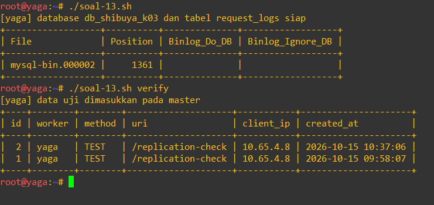

Nah kenapa ada 2 pada saat verify? sebenernya saya coba terlebih dahulu ini apakah scriptnya bisa atau tidak dan ternyata bisa. Ada permasalahan disini yaitu tidak bisa mendownload DB yang mengakibatkan perbaikan sedikit. yaitu menambahkan `up echo "nameserver 192.168.122.1" > /etc/resolv.conf` yang bikin bisa ping google.com dengan awalnya tidak bisa. Habis itu saya coba check beberapa di debinet model -> dia tidak ada juga configurenya jadinya saya harus menambahkan beberapa. Lalu

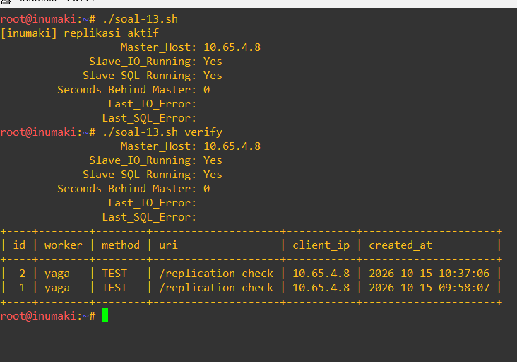

berikut hasilnya pada `inumaki`. Sama seperti sebelumnya mengecheck di `yaga`. Disini `yaga` nyala dan data yang didapat dari inumaki berasal dari `yaga`. Nah sebenernya script ini berjalan dengan mengecheck nodenya apakah dia `yaga` atau `inumaki`. Kemudian ada case dengan nodenya dan actionnya. Nah pada scriptnya itu kan `./script.sh` -> dia bakal check terlebih dahulu node namenya. Kalau misal ketemu contoh: yaga, dia akan mengecheck argument setelah `./script.sh`. Kalau tidak ada -> dia akan masuk ke setup. Tapi kalau misal ada argumen contoh `verify` -> dia akan menjalankan script node:script dengan script: verify

14. 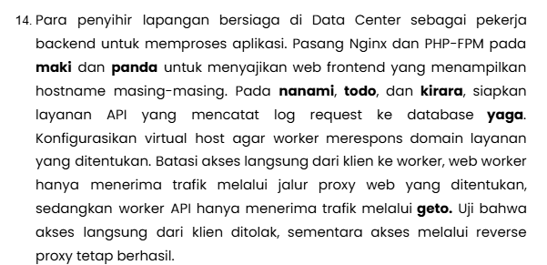

Jadi pada soal ini diminta untuk memasang nginx dan php-fpm pada node `maki` dan `panda`. Selanjutnya memasang api pada node `nanami`, `todo`, dan `kirara` yang mana apinya ini harus terhubung kepada database `yaga`. Berikut scriptnya:

```sh
#!/bin/sh
set -eu

PREFIX="10.65"
NODE="$(hostname)"
ACTION="${1:-setup}"

DOMAIN="jujutsu.k03.com"
GOJO_IP="${PREFIX}.1.4"
GETO_IP="${PREFIX}.4.2"

DB_HOST="${PREFIX}.4.8"
DB_NAME="db_shibuya_k03"
DB_USER="shibuya"
DB_PASS="shibuya_pass"

PACKAGES="nginx php-fpm php-cli php-mysql curl"
SITE_FILE="/etc/nginx/sites-available/jujutsu"
SITE_LINK="/etc/nginx/sites-enabled/jujutsu"
WEB_ROOT="/var/www/jujutsu"
API_ROOT="/var/www/api"
DB_CONF_DIR="/etc/jujutsu"

log() {
    printf '[%s] %s\n' "$NODE" "$1"
}

die() {
    printf '[%s] ERROR: %s\n' "$NODE" "$1" >&2
    exit 1
}

case "$NODE" in
    maki|panda)
        ROLE="web"
        ALLOW_IP="$GOJO_IP"
        ;;
    nanami|todo|kirara)
        ROLE="api"
        ALLOW_IP="$GETO_IP"
        ;;
    *)
        die "node tidak dikenali, jalankan di maki, panda, nanami, todo, atau kirara"
        ;;
esac

require_root() {
    [ "$(id -u)" -eq 0 ] || die "script harus dijalankan sebagai root"
}

install_packages() {
    missing=0
    for pkg in $PACKAGES; do
        dpkg -s "$pkg" >/dev/null 2>&1 || missing=1
    done
    [ "$missing" -eq 1 ] || return 0
    export DEBIAN_FRONTEND=noninteractive
    apt-get update -y >/dev/null || die "apt-get update gagal, periksa resolv.conf"
    apt-get install -y $PACKAGES >/dev/null || die "instalasi paket gagal"
}

detect_php() {
    PHP_VER="$(ls /etc/php | sort -V | tail -n 1)"
    [ -n "$PHP_VER" ] || die "versi php tidak terdeteksi"
    PHP_SOCK="/run/php/php${PHP_VER}-fpm.sock"
}

write_web_app() {
    mkdir -p "$WEB_ROOT"
    cat > "$WEB_ROOT/index.php" <<'PHP'
<?php
$hostname = gethostname();
?>
<!DOCTYPE html>
<html lang="id">
<head>
    <meta charset="utf-8">
    <title>Jujutsu High</title>
</head>
<body>
    <h1>Jujutsu High Frontend</h1>
    <p>Served by: <?= htmlspecialchars($hostname, ENT_QUOTES, 'UTF-8') ?></p>
</body>
</html>
PHP
    chown -R www-data:www-data "$WEB_ROOT"
}

write_api_app() {
    mkdir -p "$API_ROOT" "$DB_CONF_DIR"

    cat > "$DB_CONF_DIR/db.php" <<EOF
<?php
return [
    'host' => '${DB_HOST}',
    'name' => '${DB_NAME}',
    'user' => '${DB_USER}',
    'pass' => '${DB_PASS}',
    'trusted_proxies' => ['${GETO_IP}'],
];
EOF
    chown root:www-data "$DB_CONF_DIR/db.php"
    chmod 640 "$DB_CONF_DIR/db.php"

    cat > "$API_ROOT/index.php" <<'PHP'
<?php
header('Content-Type: application/json');

$config = require '/etc/jujutsu/db.php';
$worker = gethostname();
$remote = $_SERVER['REMOTE_ADDR'] ?? '';
$client = $remote;

if (in_array($remote, $config['trusted_proxies'], true)) {
    $candidate = $_SERVER['HTTP_X_REAL_IP'] ?? '';
    if (filter_var($candidate, FILTER_VALIDATE_IP)) {
        $client = $candidate;
    }
}

try {
    $pdo = new PDO(
        sprintf('mysql:host=%s;dbname=%s;charset=utf8mb4', $config['host'], $config['name']),
        $config['user'],
        $config['pass'],
        [PDO::ATTR_ERRMODE => PDO::ERRMODE_EXCEPTION, PDO::ATTR_TIMEOUT => 3]
    );
    $stmt = $pdo->prepare('INSERT INTO request_logs (worker, method, uri, client_ip) VALUES (?, ?, ?, ?)');
    $stmt->execute([
        $worker,
        substr($_SERVER['REQUEST_METHOD'] ?? 'GET', 0, 10),
        substr($_SERVER['REQUEST_URI'] ?? '/', 0, 255),
        $client,
    ]);
    echo json_encode([
        'status' => 'ok',
        'worker' => $worker,
        'client_ip' => $client,
        'log_id' => (int) $pdo->lastInsertId(),
    ]);
} catch (PDOException $e) {
    http_response_code(500);
    echo json_encode([
        'status' => 'error',
        'worker' => $worker,
        'message' => 'database unavailable',
    ]);
}
PHP
    chown -R www-data:www-data "$API_ROOT"
}

write_web_vhost() {
    cat > "$SITE_FILE" <<EOF
server {
    listen 80 default_server;
    server_name ${DOMAIN} www.${DOMAIN};

    allow 127.0.0.1;
    allow ${ALLOW_IP};
    deny all;

    root ${WEB_ROOT};
    index index.php;

    location / {
        try_files \$uri \$uri/ =404;
    }

    location ~ \.php\$ {
        include snippets/fastcgi-php.conf;
        fastcgi_pass unix:${PHP_SOCK};
    }
}
EOF
}

write_api_vhost() {
    cat > "$SITE_FILE" <<EOF
server {
    listen 80 default_server;
    server_name ${DOMAIN} www.${DOMAIN};

    allow 127.0.0.1;
    allow ${ALLOW_IP};
    deny all;

    root ${API_ROOT};

    location ~ ^/api(/|\$) {
        include fastcgi_params;
        fastcgi_param SCRIPT_FILENAME ${API_ROOT}/index.php;
        fastcgi_pass unix:${PHP_SOCK};
    }

    location / {
        return 404;
    }
}
EOF
}

enable_site() {
    rm -f /etc/nginx/sites-enabled/default
    ln -sf "$SITE_FILE" "$SITE_LINK"
    nginx -t >/dev/null 2>&1 || { nginx -t; die "konfigurasi nginx tidak valid"; }
}

restart_services() {
    service "php${PHP_VER}-fpm" restart >/dev/null 2>&1 || die "php${PHP_VER}-fpm gagal dijalankan"
    service nginx restart >/dev/null 2>&1 || die "nginx gagal dijalankan"
    tries=0
    until [ -S "$PHP_SOCK" ]; do
        tries=$((tries + 1))
        [ "$tries" -le 15 ] || die "socket ${PHP_SOCK} tidak tersedia"
        sleep 1
    done
}

check_database() {
    [ "$ROLE" = "api" ] || return 0
    if php -r "try { new PDO('mysql:host=${DB_HOST};dbname=${DB_NAME}', '${DB_USER}', '${DB_PASS}', [PDO::ATTR_TIMEOUT => 3]); } catch (Exception \$e) { exit(1); }"; then
        log "koneksi ke database ${DB_HOST} berhasil"
    else
        log "peringatan: database ${DB_HOST} belum dapat dihubungi"
    fi
}

setup_node() {
    install_packages
    detect_php
    if [ "$ROLE" = "web" ]; then
        write_web_app
        write_web_vhost
    else
        write_api_app
        write_api_vhost
    fi
    enable_site
    restart_services
    check_database
    log "worker ${ROLE} siap, hanya menerima trafik dari ${ALLOW_IP}"
}

verify_node() {
    own_ip="$(ip -4 -o addr show dev eth0 | awk '{print $4}' | cut -d/ -f1 | head -n 1)"
    path="/"
    [ "$ROLE" = "api" ] && path="/api"

    local_code="$(curl -s -o /dev/null -w '%{http_code}' -H "Host: ${DOMAIN}" "http://127.0.0.1${path}")"
    direct_code="$(curl -s -o /dev/null -w '%{http_code}' -H "Host: ${DOMAIN}" "http://${own_ip}${path}")"

    log "akses lokal 127.0.0.1${path}: HTTP ${local_code}"
    log "akses langsung via ${own_ip}${path}: HTTP ${direct_code}"
    curl -s -H "Host: ${DOMAIN}" "http://127.0.0.1${path}"
    printf '\n'
}

require_root

case "$ACTION" in
    setup)
        setup_node
        ;;
    verify)
        verify_node
        ;;
    *)
        die "penggunaan: script.sh [setup|verify]"
        ;;
esac
```

Nah disini saya jalankan scriptnya pada maki dengan hasil seperti berikut:

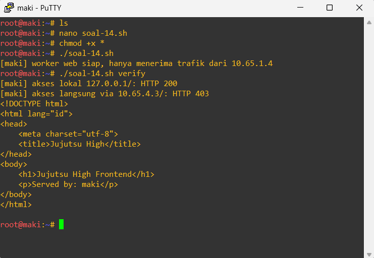

Hasilnya 200 yang menandakan bahwa ini berhasil dari sisi maki sebagai nodenya. Selanjutnya pada panda

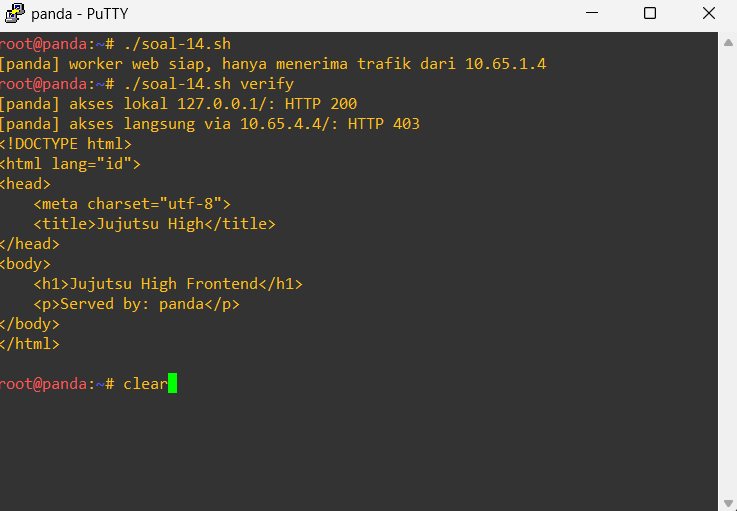

Terlihat juga berhasil pada gambar tersebut yang berarti menandakan tiap node berhasil bekerja. Selanjutnya 

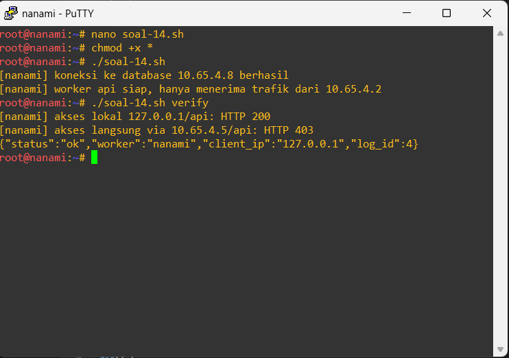

Disini juga terlihat bahwa scriptnya berhasil menandakan yang artinya pada api menunjukkan response berupa jsonnya. Sekarang kita lanjut ke client yaitu itadori

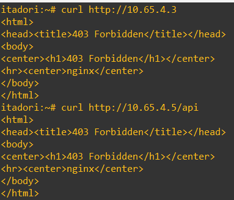

Hasilnya tersebut memenuhi bahwa client tidak bisa mengakses secara langsung dan memberikan response berupa `403` yang artinya langsung menolak pada clientnya. Nah bukti ini bisa dibuktikan melalui 

`mariadb -e "SELECT id, worker, method, uri, client_ip, created_at FROM db_shibuya_k03.request_logs ORDER BY id"` pada yaga dan inumakinya untuk mengecheck hasil dari db request. Berikut hasilnya 

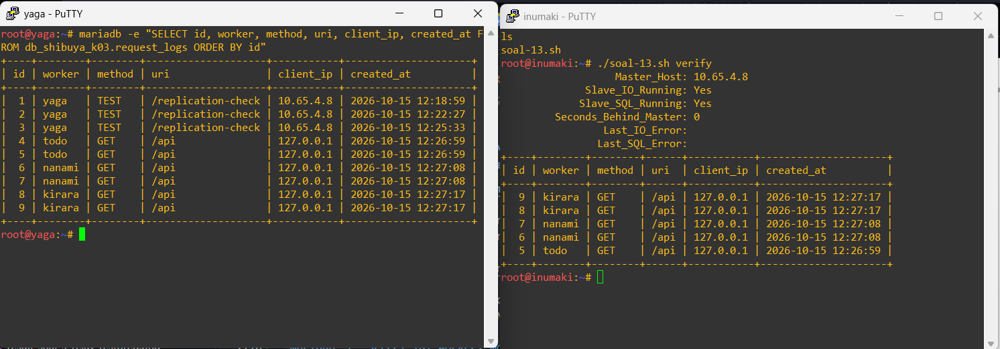

Ini dijalankan setelah issue dari docker pada jam 14:04 WIB

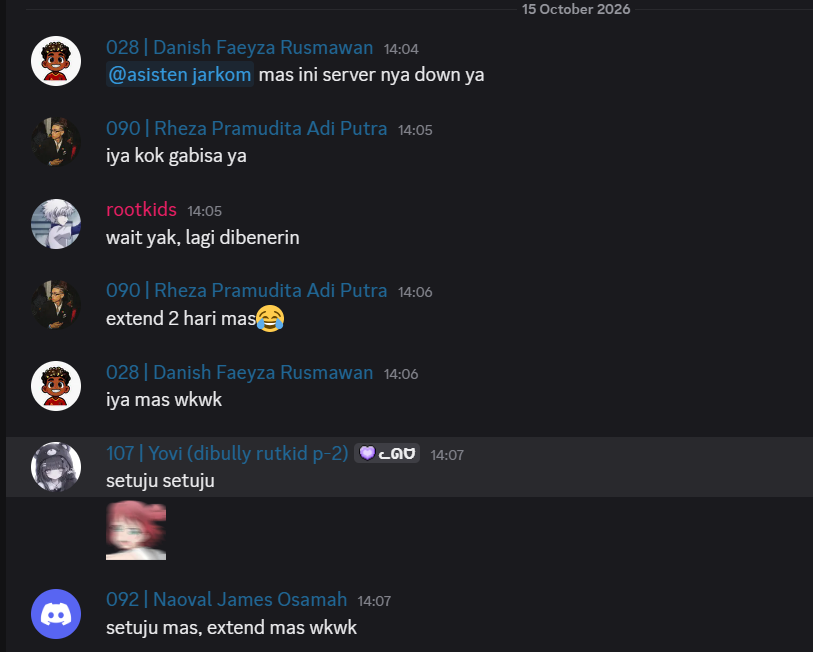

dan problem di fix pada jam 14.30. Dan saat saya menjalankan ulang script-13.sh -> masih aman. Tapi saat menjalankan script-14 ini -> permasalahan terjadi yaitu ada error pada respons jsonnya. Kelupaan foto jadinya begitu... Sekarang bukti yang di gambar sebelumnya merupakan hasil dari script yang sudah saya jalankan lagi. Disini solvingnya saya coba restart -> masih sama kemudian saya mencoba mematikan gnsnya beberapa detik (kisaran 30 detik sembari bermain whenfield) lalu menjalankannya script tersebut -> semuanya terhubung dan aman

15. 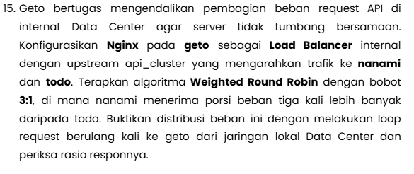

Untuk no 15 dilakukan ke node geto. Nah di node Geto ini dijankan pada server nginx sebagai `load_balancer` yang artinya setiap request yang dikirim itu nanti akan dibagi requestnya berapa. Nah cara baginya menggunakan weighted round robin dengan pembagiannya: `3:1` dengan menggunakan `api_upstream` yang mengarah ke node `nanami` dan `todo`. Scriptnya sebagai berikut:

```sh
#!/bin/sh
set -eu

PREFIX="10.65"
NODE="$(hostname)"
ACTION="${1:-setup}"
REQUESTS="${2:-40}"

DOMAIN="jujutsu.k03.com"
GOJO_IP="${PREFIX}.1.4"
GETO_IP="${PREFIX}.4.2"
NANAMI_IP="${PREFIX}.4.5"
TODO_IP="${PREFIX}.4.6"
NANAMI_WEIGHT=3
TODO_WEIGHT=1

SITE_FILE="/etc/nginx/sites-available/api-lb"
SITE_LINK="/etc/nginx/sites-enabled/api-lb"
UPSTREAM_CONF="/etc/nginx/conf.d/geto-upstream.conf"
ACCESS_CONF="/etc/nginx/conf.d/geto-access.conf"
PROXY_SNIPPET="/etc/nginx/snippets/geto-proxy.conf"
FAILOVER_SNIPPET="/etc/nginx/snippets/geto-failover.conf"
PACKAGES="nginx curl"

log() {
    printf '[%s] %s\n' "$NODE" "$1"
}

die() {
    printf '[%s] ERROR: %s\n' "$NODE" "$1" >&2
    exit 1
}

require_root() {
    [ "$(id -u)" -eq 0 ] || die "script harus dijalankan sebagai root"
}

install_packages() {
    missing=0
    for pkg in $PACKAGES; do
        dpkg -s "$pkg" >/dev/null 2>&1 || missing=1
    done
    [ "$missing" -eq 1 ] || return 0
    export DEBIAN_FRONTEND=noninteractive
    apt-get update -y >/dev/null || die "apt-get update gagal, periksa resolv.conf"
    apt-get install -y $PACKAGES >/dev/null || die "instalasi paket gagal"
}

write_upstream() {
    cat > "$UPSTREAM_CONF" <<EOF
upstream api_cluster {
    zone api_cluster 64k;
    server ${NANAMI_IP} weight=${NANAMI_WEIGHT};
    server ${TODO_IP} weight=${TODO_WEIGHT};
}
EOF
}

write_access() {
    cat > "$ACCESS_CONF" <<EOF
geo \$realip_remote_addr \$geto_peer_allowed {
    default 0;
    127.0.0.1 1;
    ${GOJO_IP} 1;
    ${PREFIX}.4.0/24 1;
}
EOF
}

write_snippets() {
    if [ ! -f "$PROXY_SNIPPET" ]; then
        cat > "$PROXY_SNIPPET" <<'EOF'
proxy_http_version 1.1;
proxy_set_header Connection "";
proxy_set_header Host $host;
EOF
    fi
    [ -f "$FAILOVER_SNIPPET" ] || : > "$FAILOVER_SNIPPET"
}

write_vhost() {
    cat > "$SITE_FILE" <<EOF
server {
    listen 80 default_server;
    server_name ${DOMAIN} www.${DOMAIN};

    if (\$geto_peer_allowed = 0) {
        return 403;
    }

    location /api {
        proxy_pass http://api_cluster;
        include snippets/geto-proxy.conf;
        include snippets/geto-failover.conf;
    }

    location / {
        return 404;
    }
}
EOF
}

enable_site() {
    rm -f /etc/nginx/sites-enabled/default
    ln -sf "$SITE_FILE" "$SITE_LINK"
    nginx -t >/dev/null 2>&1 || { nginx -t; die "konfigurasi nginx tidak valid"; }
}

restart_nginx() {
    service nginx restart >/dev/null 2>&1 || die "nginx gagal dijalankan"
}

setup_geto() {
    [ "$NODE" = "geto" ] || die "setup hanya dijalankan di geto"
    install_packages
    write_upstream
    write_access
    write_snippets
    write_vhost
    enable_site
    restart_nginx
    log "load balancer api_cluster aktif (${NANAMI_IP}:${NANAMI_WEIGHT}, ${TODO_IP}:${TODO_WEIGHT})"
}

count_worker() {
    printf '%s\n' "$1" | awk -v w="$2" '$2 == w { print $1 }'
}

verify_balance() {
    case "$REQUESTS" in
        ''|*[!0-9]*) die "jumlah request harus berupa angka" ;;
    esac

    log "mengirim ${REQUESTS} request ke http://${GETO_IP}/api"
    results="$(
        i=1
        while [ "$i" -le "$REQUESTS" ]; do
            worker="$(curl -s -m 5 "http://${GETO_IP}/api" | sed -n 's/.*"worker":"\([^"]*\)".*/\1/p')"
            printf '%s\n' "${worker:-error}"
            i=$((i + 1))
        done | sort | uniq -c
    )"

    printf '%s\n' "$results"

    nanami="$(count_worker "$results" nanami)"
    todo="$(count_worker "$results" todo)"
    nanami="${nanami:-0}"
    todo="${todo:-0}"

    if [ "$todo" -gt 0 ]; then
        ratio="$(awk -v n="$nanami" -v t="$todo" 'BEGIN { printf "%.2f", n / t }')"
    else
        ratio="n/a"
    fi
    log "nanami=${nanami} todo=${todo} rasio=${ratio} (target ${NANAMI_WEIGHT}:${TODO_WEIGHT})"
}

case "$ACTION" in
    setup)
        require_root
        setup_geto
        ;;
    verify)
        verify_balance
        ;;
    *)
        die "penggunaan: soal-15.sh [setup|verify [jumlah_request]]"
        ;;
esac
```

Nah pada script ini dilakukan setup untuk load balancingnya. Selanjutnya ketika user menjalankan `./soal-15.sh verify` dia akan melakukan weight round robin untuk mengulang scriptnya tersebut agar hasilnya lebih adil kepada nanami yang lebih berat dan todo hanya sedikit. Hasilnya sebagai berikut

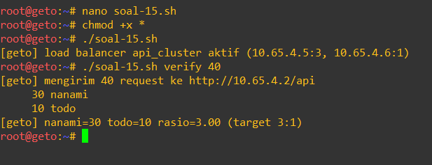

16. 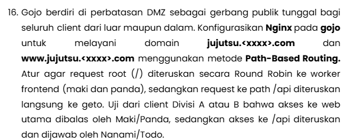

Untuk soal ini menggunakan node: `gojo` dan menggunakan konfigurasi `nginx` agar melayani domain `jujutsu.<xxxx>.com` dan `www.jujutsu.<xxxx>.com`. Nah path yang digunakan adalah [Path-based routing](https://medium.com/@jadhav.swatissj99/path-based-routing-in-kubernetes-ingress-a-detailed-explanation-38178dcc0b97) jadi path based routing yang saya dapat itu fitur dari kubernets yang bisa ngerouting ke service yang berbeda. Jadi misal kalau ke `/api` gitu bisa ngerotasi ke yang lain begitulah. `This means that traffic can be directed to different backend services depending on the specific path in the request URL.` penjelasannya seperti ini. Selanjutnya script:

```sh
#!/bin/sh
set -eu

PREFIX="10.65"
NODE="$(hostname)"
ACTION="${1:-setup}"
REQUESTS="${2:-40}"

DOMAIN="jujutsu.k03.com"
GOJO_IP="${PREFIX}.1.4"
GETO_IP="${PREFIX}.4.2"
MAKI_IP="${PREFIX}.4.3"
PANDA_IP="${PREFIX}.4.4"

SITE_FILE="/etc/nginx/sites-available/gojo"
SITE_LINK="/etc/nginx/sites-enabled/gojo"
LOG_CONF="/etc/nginx/conf.d/gojo-log.conf"
PROXY_SNIPPET="/etc/nginx/snippets/gojo-proxy.conf"
WEB_SNIPPET="/etc/nginx/snippets/gojo-web.conf"
API_SNIPPET="/etc/nginx/snippets/gojo-api.conf"
ACCESS_LOG="/var/log/nginx/gojo.access.log"
PACKAGES="nginx curl"

WEB_EXPR='s/.*Served by: \([A-Za-z0-9_-]*\).*/\1/p'
API_EXPR='s/.*"worker":"\([^"]*\)".*/\1/p'

log() {
    printf '[%s] %s\n' "$NODE" "$1"
}

die() {
    printf '[%s] ERROR: %s\n' "$NODE" "$1" >&2
    exit 1
}

require_root() {
    [ "$(id -u)" -eq 0 ] || die "script harus dijalankan sebagai root"
}

install_packages() {
    missing=0
    for pkg in $PACKAGES; do
        dpkg -s "$pkg" >/dev/null 2>&1 || missing=1
    done
    [ "$missing" -eq 1 ] || return 0
    export DEBIAN_FRONTEND=noninteractive
    apt-get update -y >/dev/null || die "apt-get update gagal, periksa resolv.co                                                                                                                                   nf"
    apt-get install -y $PACKAGES >/dev/null || die "instalasi paket gagal"
}

write_log_format() {
    cat > "$LOG_CONF" <<'EOF'
log_format gojo_main 'ip=$remote_addr time=$time_iso8601 uri=$request_uri status                                                                                                                                   =$status bytes=$body_bytes_sent rt=$request_time cache=$upstream_cache_status li                                                                                                                                   mit=$limit_req_status up="$upstream_status" addr="$upstream_addr"';
EOF
}

write_snippets() {
    if [ ! -f "$PROXY_SNIPPET" ]; then
        cat > "$PROXY_SNIPPET" <<'EOF'
proxy_http_version 1.1;
proxy_set_header Connection "";
proxy_set_header Host $host;
EOF
    fi
    [ -f "$WEB_SNIPPET" ] || : > "$WEB_SNIPPET"
    [ -f "$API_SNIPPET" ] || : > "$API_SNIPPET"
}

write_vhost() {
    cat > "$SITE_FILE" <<EOF
upstream web_cluster {
    server ${MAKI_IP};
    server ${PANDA_IP};
}

server {
    listen 80 default_server;
    server_name _;
    return 404;
}

server {
    listen 80;
    server_name ${DOMAIN} www.${DOMAIN};
    access_log ${ACCESS_LOG} gojo_main;

    location ~ ^/api(/|\$) {
        proxy_pass http://${GETO_IP};
        include snippets/gojo-proxy.conf;
        include snippets/gojo-api.conf;
    }

    location / {
        proxy_pass http://web_cluster;
        include snippets/gojo-proxy.conf;
        include snippets/gojo-web.conf;
    }
}
EOF
}

enable_site() {
    rm -f /etc/nginx/sites-enabled/default
    ln -sf "$SITE_FILE" "$SITE_LINK"
    nginx -t >/dev/null 2>&1 || { nginx -t; die "konfigurasi nginx tidak valid";                                                                                                                                    }
}

restart_nginx() {
    service nginx restart >/dev/null 2>&1 || die "nginx gagal dijalankan"
}

setup_gojo() {
    [ "$NODE" = "gojo" ] || die "setup hanya dijalankan di gojo"
    install_packages
    write_log_format
    write_snippets
    write_vhost
    enable_site
    restart_nginx
    log "gojo aktif: / ke maki dan panda, /api ke geto"
}

sample() {
    path="$1"
    expr="$2"
    i=1
    while [ "$i" -le "$REQUESTS" ]; do
        value="$(curl -s -m 5 --resolve "${DOMAIN}:80:${GOJO_IP}" "http://${DOMA                                                                                                                                   IN}${path}" | sed -n "$expr")"
        printf '%s\n' "${value:-error}"
        i=$((i + 1))
    done | sort | uniq -c
}

verify_routing() {
    case "$REQUESTS" in
        ''|*[!0-9]*) die "jumlah request harus berupa angka" ;;
    esac

    www_code="$(curl -s -o /dev/null -m 5 -w '%{http_code}' --resolve "www.${DOM                                                                                                                                   AIN}:80:${GOJO_IP}" "http://www.${DOMAIN}/")"
    log "www.${DOMAIN}/ : HTTP ${www_code}"

    log "${REQUESTS} request ke http://${DOMAIN}/ (diharapkan dijawab maki dan p                                                                                                                                   anda)"
    sample "/" "$WEB_EXPR"

    log "${REQUESTS} request ke http://${DOMAIN}/api (diharapkan dijawab nanami                                                                                                                                    dan todo)"
    sample "/api" "$API_EXPR"
}

case "$ACTION" in
    setup)
        require_root
        setup_gojo
        ;;
    verify)
        verify_routing
        ;;
    *)
        die "penggunaan: soal-16.sh [setup|verify [jumlah_request]]"
        ;;
esac
```

nah hasilnya seperti ini

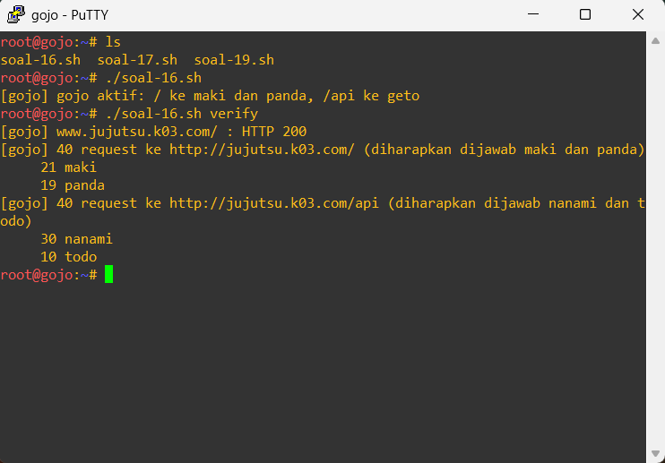

Lalu di sisi client terdapat beberapa command, seperti berikut:

```text
printf 'nameserver 10.65.1.2\nnameserver 10.65.1.3\n' > /etc/resolv.conf
dig jujutsu.k03.com +short
curl http://jujutsu.k03.com/
curl http://jujutsu.k03.com/api
```

Nah ketika sudah dijalankan hasilnya bakal seperti ini:

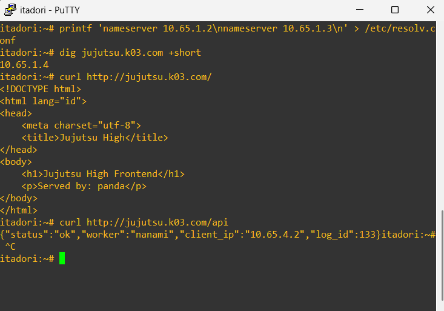

17. 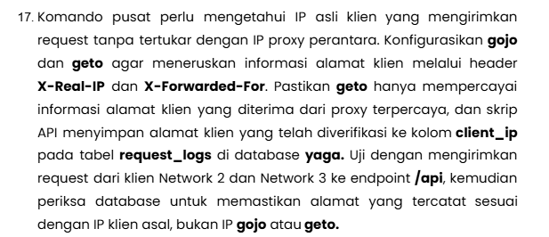

Untuk soal ini adalah mengkonfigurasi ke Gojo dan Getor buat meneruskan informasinya ke alamat client via header yaitu X-Real-IP dan X-Forwarded-For. Scriptnya jadi 1 seperti ini berdasarkan node yang sesuai:

`mariadb -e "TRUNCATE TABLE db_shibuya_k03.request_logs"` Untuk mengosongkan tabelnya di Yaga lalu kita jalankan scriptnya berikut:

```sh
#!/bin/sh
set -eu

PREFIX="10.65"
NODE="$(hostname)"
ACTION="${1:-setup}"

DOMAIN="jujutsu.k03.com"
GOJO_IP="${PREFIX}.1.4"
GETO_IP="${PREFIX}.4.2"
DB_NAME="db_shibuya_k03"
SPOOF_IP="9.9.9.9"

GOJO_PROXY_SNIPPET="/etc/nginx/snippets/gojo-proxy.conf"
GETO_PROXY_SNIPPET="/etc/nginx/snippets/geto-proxy.conf"
GETO_REALIP_CONF="/etc/nginx/conf.d/geto-realip.conf"

log() {
    printf '[%s] %s\n' "$NODE" "$1"
}

die() {
    printf '[%s] ERROR: %s\n' "$NODE" "$1" >&2
    exit 1
}

require_root() {
    [ "$(id -u)" -eq 0 ] || die "script harus dijalankan sebagai root"
}

reload_nginx() {
    nginx -t >/dev/null 2>&1 || { nginx -t; die "konfigurasi nginx tidak valid"; }
    nginx -s reload || die "nginx gagal direload"
}

own_ip() {
    ip -4 -o addr show dev eth0 | awk '{print $4}' | cut -d/ -f1 | head -n 1
}

setup_gojo() {
    [ -d /etc/nginx/snippets ] || die "jalankan soal-16.sh di gojo terlebih dahulu"
    cat > "$GOJO_PROXY_SNIPPET" <<'EOF'
proxy_http_version 1.1;
proxy_set_header Connection "";
proxy_set_header Host $host;
proxy_set_header X-Real-IP $remote_addr;
proxy_set_header X-Forwarded-For $proxy_add_x_forwarded_for;
EOF
    reload_nginx
    log "gojo meneruskan X-Real-IP dan X-Forwarded-For"
}

setup_geto() {
    [ -d /etc/nginx/snippets ] || die "jalankan soal-15.sh di geto terlebih dahulu"

    cat > "$GETO_REALIP_CONF" <<EOF
set_real_ip_from ${GOJO_IP};
real_ip_header X-Forwarded-For;
real_ip_recursive on;

map \$http_x_forwarded_for \$geto_forwarded_for {
    default "\$http_x_forwarded_for, \$realip_remote_addr";
    "" \$realip_remote_addr;
}
EOF

    cat > "$GETO_PROXY_SNIPPET" <<'EOF'
proxy_http_version 1.1;
proxy_set_header Connection "";
proxy_set_header Host $host;
proxy_set_header X-Real-IP $remote_addr;
proxy_set_header X-Forwarded-For $geto_forwarded_for;
EOF
    reload_nginx
    log "geto hanya mempercayai alamat client dari proxy ${GOJO_IP}"
}

extract_ip() {
    printf '%s' "$1" | sed -n 's/.*"client_ip":"\([^"]*\)".*/\1/p'
}

report_match() {
    recorded="$(extract_ip "$3")"
    if [ "$recorded" = "$2" ]; then
        verdict="sesuai"
    else
        verdict="TIDAK SESUAI"
    fi
    log "$1: ip_client=$2 tercatat=${recorded:-kosong} (${verdict})"
}

verify_client() {
    own="$(own_ip)"
    plain="$(curl -s -m 5 --resolve "${DOMAIN}:80:${GOJO_IP}" "http://${DOMAIN}/api")"
    spoofed="$(curl -s -m 5 --resolve "${DOMAIN}:80:${GOJO_IP}" \
        -H "X-Forwarded-For: ${SPOOF_IP}" -H "X-Real-IP: ${SPOOF_IP}" \
        "http://${DOMAIN}/api")"
    report_match "request normal via gojo" "$own" "$plain"
    report_match "request dengan header palsu via gojo" "$own" "$spoofed"
}

verify_spoof() {
    own="$(own_ip)"
    response="$(curl -s -m 5 -H "Host: ${DOMAIN}" \
        -H "X-Forwarded-For: ${SPOOF_IP}" -H "X-Real-IP: ${SPOOF_IP}" \
        "http://${GETO_IP}/api")"
    report_match "akses langsung ke geto dengan header palsu" "$own" "$response"
}

show_db() {
    mariadb -e "SELECT id, worker, method, uri, client_ip, created_at FROM ${DB_NAME}.request_logs ORDER BY id DESC LIMIT 10"
}

case "$ACTION" in
    setup)
        require_root
        case "$NODE" in
            gojo) setup_gojo ;;
            geto) setup_geto ;;
            *) die "setup dijalankan di gojo dan geto" ;;
        esac
        ;;
    verify)
        verify_client
        ;;
    spoof)
        verify_spoof
        ;;
    db)
        show_db
        ;;
    *)
        die "penggunaan: soal-17.sh [setup|verify|spoof|db]"
        ;;
esac
```

Setelah itu dijalankan ke beberapa node:
- Gojo (`./soal-17.sh`) -> 
- Geto (`./soal-17.sh`)
- Itadori (`./soal-17.sh verify`) -> 
- maki (`./soal-17.sh spoof`) -> buat spoofing
- Yaga dan inumaki (`./soal-17.sh db`) -> buat check hasilnya

Hasilnya seperti ini

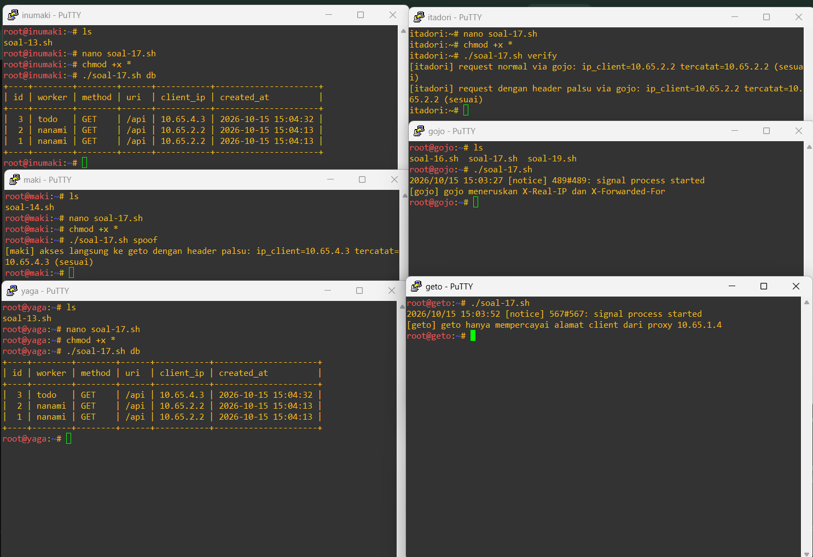

18. 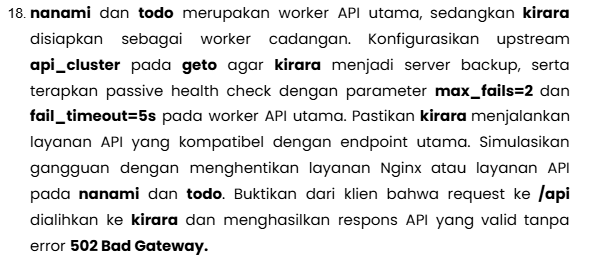

Untuk ini Api utamanya berada di nanami dan todo sedangkan kirara adalah cadangan. Kemudian dari geto diarahkan ke nanami dan todo sebagai api utama dan kirara adalah cadangan. Berikut scriptnya jadi 1:

```sh
#!/bin/sh
set -eu

PREFIX="10.65"
NODE="$(hostname)"
ACTION="${1:-setup}"
TARGET="${2:-nginx}"
REQUESTS="${2:-40}"

DOMAIN="jujutsu.k03.com"
GOJO_IP="${PREFIX}.1.4"
NANAMI_IP="${PREFIX}.4.5"
TODO_IP="${PREFIX}.4.6"
KIRARA_IP="${PREFIX}.4.7"
NANAMI_WEIGHT=3
TODO_WEIGHT=1
MAX_FAILS=2
FAIL_TIMEOUT="5s"

UPSTREAM_CONF="/etc/nginx/conf.d/geto-upstream.conf"
FAILOVER_SNIPPET="/etc/nginx/snippets/geto-failover.conf"

log() {
    printf '[%s] %s\n' "$NODE" "$1"
}

die() {
    printf '[%s] ERROR: %s\n' "$NODE" "$1" >&2
    exit 1
}

require_root() {
    [ "$(id -u)" -eq 0 ] || die "script harus dijalankan sebagai root"
}

reload_nginx() {
    nginx -t >/dev/null 2>&1 || { nginx -t; die "konfigurasi nginx tidak valid"; }
    nginx -s reload || die "nginx gagal direload"
}

check_backends() {
    for entry in "nanami:${NANAMI_IP}" "todo:${TODO_IP}" "kirara:${KIRARA_IP}"; do
        name="${entry%%:*}"
        ip="${entry#*:}"
        code="$(curl -s -o /dev/null -m 5 -w '%{http_code}' -H "Host: ${DOMAIN}" "http://${ip}/api" || true)"
        log "backend ${name} (${ip}) /api: HTTP ${code:-000}"
    done
}

setup_geto() {
    [ "$NODE" = "geto" ] || die "setup hanya dijalankan di geto"
    [ -d /etc/nginx/snippets ] || die "jalankan soal-15.sh di geto terlebih dahulu"

    cat > "$UPSTREAM_CONF" <<EOF
upstream api_cluster {
    zone api_cluster 64k;
    server ${NANAMI_IP} weight=${NANAMI_WEIGHT} max_fails=${MAX_FAILS} fail_timeout=${FAIL_TIMEOUT};
    server ${TODO_IP} weight=${TODO_WEIGHT} max_fails=${MAX_FAILS} fail_timeout=${FAIL_TIMEOUT};
    server ${KIRARA_IP} backup;
}
EOF

    cat > "$FAILOVER_SNIPPET" <<'EOF'
proxy_connect_timeout 2s;
proxy_next_upstream error timeout http_502 http_503 http_504;
proxy_next_upstream_tries 3;
EOF

    reload_nginx
    log "kirara menjadi backup, max_fails=${MAX_FAILS} fail_timeout=${FAIL_TIMEOUT}"
    check_backends
}

service_name() {
    case "$1" in
        nginx)
            printf 'nginx'
            ;;
        php)
            version="$(ls /etc/php | sort -V | tail -n 1)"
            [ -n "$version" ] || die "versi php tidak terdeteksi"
            printf 'php%s-fpm' "$version"
            ;;
        *)
            die "layanan harus nginx atau php"
            ;;
    esac
}

require_worker() {
    case "$NODE" in
        nanami|todo|kirara) ;;
        *) die "perintah ini dijalankan di nanami, todo, atau kirara" ;;
    esac
}

stop_worker() {
    require_worker
    svc="$(service_name "$TARGET")"
    service "$svc" stop >/dev/null 2>&1 || die "gagal menghentikan ${svc}"
    log "layanan ${svc} dihentikan"
}

start_worker() {
    require_worker
    svc="$(service_name "$TARGET")"
    service "$svc" start >/dev/null 2>&1 || die "gagal menjalankan ${svc}"
    log "layanan ${svc} dijalankan"
}

verify_failover() {
    case "$REQUESTS" in
        ''|*[!0-9]*) die "jumlah request harus berupa angka" ;;
    esac

    tmp="$(mktemp)"
    log "${REQUESTS} request ke http://${DOMAIN}/api"
    results="$(
        i=1
        while [ "$i" -le "$REQUESTS" ]; do
            code="$(curl -s -o "$tmp" -m 10 -w '%{http_code}' --resolve "${DOMAIN}:80:${GOJO_IP}" "http://${DOMAIN}/api" || true)"
            worker="$(sed -n 's/.*"worker":"\([^"]*\)".*/\1/p' "$tmp")"
            printf '%s %s\n' "${code:-000}" "${worker:-none}"
            i=$((i + 1))
        done | sort | uniq -c
    )"
    rm -f "$tmp"

    printf '%s\n' "$results"
    bad="$(printf '%s\n' "$results" | awk '$2 == "502" { sum += $1 } END { print sum + 0 }')"
    log "jumlah respons 502: ${bad}"
}

case "$ACTION" in
    setup)
        require_root
        setup_geto
        ;;
    stop)
        require_root
        stop_worker
        ;;
    start)
        require_root
        start_worker
        ;;
    verify)
        verify_failover
        ;;
    *)
        die "penggunaan: soal-18.sh [setup|stop [nginx|php]|start [nginx|php]|verify [jumlah_request]]"
        ;;
esac
```

Nah disini scriptnya untuk:
- Geto (configurasi agar ngarahkan ke nanami dan todo buat api utamanya dan kirara sebagai cadangannya)
- Nanami dan todo -> sebagai percobaan untuk apinya dimatikan dan dihidupkan
- Client (itadori) -> sebagai testinger (`./soal-18.sh verify`)

Nah hasilnya sebagai berikut

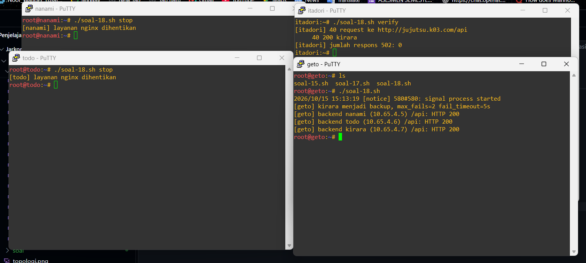

ini membuktikan bahwa semua api yang dimatikan (nanami dan todo) diarahkan ke kirara dan membuktikan bahwa respons 502 itu 0.

Ini hasilnya kalau dihidupkan:

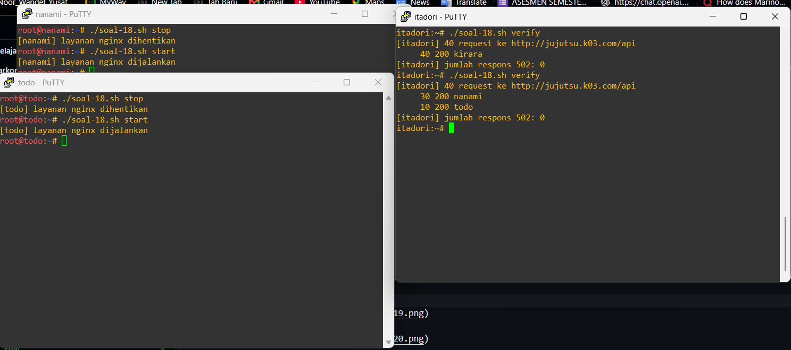

kalau misal nanami dan todo hidup -> dia diarahkan ke api utamanya

19. 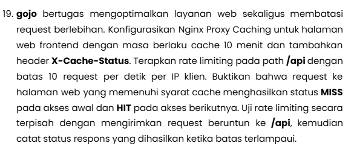

Ini buat optimize pada gojo. Jadi di node Gojo untuk mengoptimalkan layanan webnya dan membatasi request berlebihan. Scriptnya dijadikan 1 sebagai berikut:

```sh
#!/bin/sh
set -eu

PREFIX="10.65"
NODE="$(hostname)"
ACTION="${1:-setup}"
BURST_REQUESTS="${2:-30}"

DOMAIN="jujutsu.k03.com"
GOJO_IP="${PREFIX}.1.4"

ZONES_CONF="/etc/nginx/conf.d/gojo-zones.conf"
WEB_SNIPPET="/etc/nginx/snippets/gojo-web.conf"
API_SNIPPET="/etc/nginx/snippets/gojo-api.conf"
CACHE_DIR="/var/cache/nginx/gojo"

log() {
    printf '[%s] %s\n' "$NODE" "$1"
}

die() {
    printf '[%s] ERROR: %s\n' "$NODE" "$1" >&2
    exit 1
}

require_root() {
    [ "$(id -u)" -eq 0 ] || die "script harus dijalankan sebagai root"
}

reload_nginx() {
    nginx -t >/dev/null 2>&1 || { nginx -t; die "konfigurasi nginx tidak valid"; }
    nginx -s reload || die "nginx gagal direload"
}

setup_gojo() {
    [ "$NODE" = "gojo" ] || die "setup hanya dijalankan di gojo"
    [ -d /etc/nginx/snippets ] || die "jalankan soal-16.sh di gojo terlebih dahulu"

    mkdir -p "$CACHE_DIR"

    cat > "$ZONES_CONF" <<'EOF'
proxy_cache_path /var/cache/nginx/gojo levels=1:2 keys_zone=web_cache:10m max_size=100m inactive=10m use_temp_path=off;
limit_req_zone $binary_remote_addr zone=api_limit:10m rate=10r/s;
EOF

    cat > "$WEB_SNIPPET" <<'EOF'
proxy_cache web_cache;
proxy_cache_key $scheme$host$request_uri;
proxy_cache_valid 200 10m;
add_header X-Cache-Status $upstream_cache_status always;
EOF

    cat > "$API_SNIPPET" <<'EOF'
limit_req zone=api_limit burst=5 nodelay;
limit_req_status 429;
EOF

    rm -f "${API_SNIPPET}.bak"
    reload_nginx
    log "cache web 10 menit dan rate limit /api 10 r/s per IP aktif"
}

verify_cache() {
    url="http://${DOMAIN}/?cache_test=$(date +%s)"
    n=1
    while [ "$n" -le 3 ]; do
        status="$(curl -s -D - -o /dev/null -m 5 --resolve "${DOMAIN}:80:${GOJO_IP}" "$url" \
            | tr -d '\r' \
            | awk -F': ' 'tolower($1) == "x-cache-status" { print $2 }')"
        log "request ${n} ke ${url}: X-Cache-Status ${status:-tidak ada}"
        n=$((n + 1))
    done
}

verify_limit() {
    case "$BURST_REQUESTS" in
        ''|*[!0-9]*) die "jumlah request harus berupa angka" ;;
    esac

    log "${BURST_REQUESTS} request bersamaan ke http://${DOMAIN}/api"
    results="$(
        i=1
        while [ "$i" -le "$BURST_REQUESTS" ]; do
            curl -s -o /dev/null -m 10 -w '%{http_code}\n' --resolve "${DOMAIN}:80:${GOJO_IP}" "http://${DOMAIN}/api" &
            i=$((i + 1))
        done
        wait
    )"
    printf '%s\n' "$results" | sort | uniq -c
}

case "$ACTION" in
    setup)
        require_root
        setup_gojo
        ;;
    cache)
        verify_cache
        ;;
    limit)
        verify_limit
        ;;
    *)
        die "penggunaan: soal-19.sh [setup|cache|limit [jumlah_request]]"
        ;;
esac
```

Disini nodenya:
- Gojo -> agar disetup langsung
- Client (itadori) -> cuman prove

Hasilnya sebagai berikut

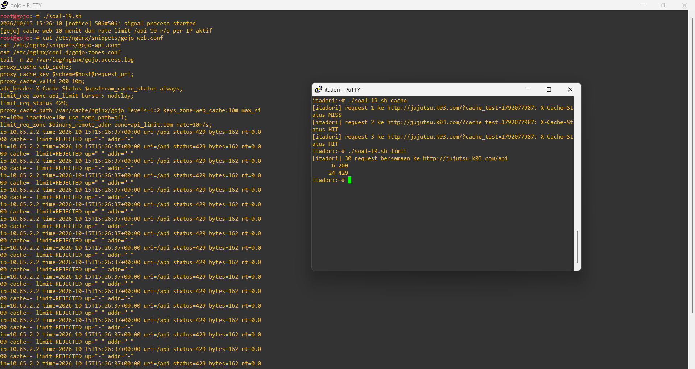

Nah untuk command yg di Gojo sebagai berikut:

```text
cat /etc/nginx/snippets/gojo-web.conf
cat /etc/nginx/snippets/gojo-api.conf
cat /etc/nginx/conf.d/gojo-zones.conf
tail -n 20 /var/log/nginx/gojo.access.log
```

buat melihat hasil dari scriptnya 

20. 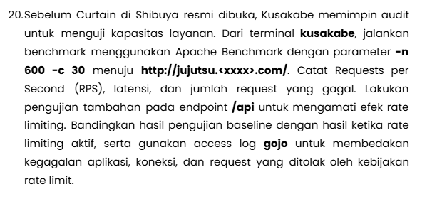

Karena sebelumnya dipasang script, disini harus dimatikan terlebih dahulu. Baru ke node `kusakabe` buat menjalankan benchmark ke apache. Kemudian menambahkan ujian tambahan kepada endpoint `/api`nya. Setelah itu melihat hasil ratenya itu dan log dari node `gojo`. Berikut scriptnya:

```sh
#!/bin/sh
set -eu

PREFIX="10.65"
NODE="$(hostname)"
ACTION="${1:-bench}"
ARG="${2:-}"

DOMAIN="jujutsu.k03.com"
GOJO_IP="${PREFIX}.1.4"
TOTAL_REQUESTS=600
CONCURRENCY=30

RESULT_FILE="${HOME:-/root}/soal20-results.txt"
API_SNIPPET="/etc/nginx/snippets/gojo-api.conf"
ACCESS_LOG="/var/log/nginx/gojo.access.log"

log() {
    printf '[%s] %s\n' "$NODE" "$1"
}

die() {
    printf '[%s] ERROR: %s\n' "$NODE" "$1" >&2
    exit 1
}

require_gojo() {
    [ "$NODE" = "gojo" ] || die "perintah ini dijalankan di gojo"
}

ensure_ab() {
    command -v ab >/dev/null 2>&1 && return 0
    if command -v apt-get >/dev/null 2>&1; then
        export DEBIAN_FRONTEND=noninteractive
        apt-get update -y >/dev/null || die "apt-get update gagal"
        apt-get install -y apache2-utils >/dev/null || die "instalasi apache2-utils gagal"
    elif command -v apk >/dev/null 2>&1; then
        apk add --no-cache apache2-utils >/dev/null || die "instalasi apache2-utils gagal"
    else
        die "package manager tidak dikenali, pasang apache2-utils secara manual"
    fi
}

resolve_target() {
    if getent hosts "$DOMAIN" >/dev/null 2>&1; then
        TARGET_HOST="$DOMAIN"
        HOST_HEADER=""
    else
        TARGET_HOST="$GOJO_IP"
        HOST_HEADER="Host: ${DOMAIN}"
    fi
}

run_ab() {
    url="http://${TARGET_HOST}$1"
    out="$2"
    if [ -n "$HOST_HEADER" ]; then
        ab -n "$TOTAL_REQUESTS" -c "$CONCURRENCY" -H "$HOST_HEADER" "$url" > "$out" 2>&1 || log "ab selesai dengan peringatan untuk ${url}"
    else
        ab -n "$TOTAL_REQUESTS" -c "$CONCURRENCY" "$url" > "$out" 2>&1 || log "ab selesai dengan peringatan untuk ${url}"
    fi
}

record_result() {
    label="$1"
    name="$2"
    out="$3"

    rps="$(awk '/^Requests per second:/ { print $4 }' "$out")"
    mean="$(awk '/^Time per request:/ { print $4; exit }' "$out")"
    p95="$(awk '$1 == "95%" { print $2 }' "$out")"
    failed="$(awk '/^Failed requests:/ { print $3 }' "$out")"
    non2xx="$(awk '/^Non-2xx responses:/ { print $3 }' "$out")"

    [ -f "$RESULT_FILE" ] || : > "$RESULT_FILE"
    tmp="$(mktemp)"
    awk -F'\t' -v l="$label" -v n="$name" '!($1 == l && $2 == n)' "$RESULT_FILE" > "$tmp"
    printf '%s\t%s\t%s\t%s\t%s\t%s\t%s\n' \
        "$label" "$name" "${rps:-0}" "${mean:-0}" "${p95:-0}" "${failed:-0}" "${non2xx:-0}" >> "$tmp"
    mv "$tmp" "$RESULT_FILE"
}

bench() {
    [ -n "$ARG" ] || die "label wajib diisi: baseline atau ratelimit"
    ensure_ab
    resolve_target

    for entry in root:/ api:/api; do
        name="${entry%%:*}"
        path="${entry#*:}"
        out="/tmp/ab_${ARG}_${name}.txt"
        log "ab -n ${TOTAL_REQUESTS} -c ${CONCURRENCY} http://${TARGET_HOST}${path}"
        run_ab "$path" "$out"
        record_result "$ARG" "$name" "$out"
        log "hasil lengkap tersimpan di ${out}"
    done

    report
}

report() {
    [ -s "$RESULT_FILE" ] || die "belum ada hasil benchmark"

    sort -t "$(printf '\t')" -k2,2 -k1,1 "$RESULT_FILE" | awk -F'\t' '
        BEGIN { printf "%-10s %-6s %-12s %-14s %-10s %-8s %s\n", "label", "path", "rps", "mean_ms", "p95_ms", "failed", "non2xx" }
        { printf "%-10s %-6s %-12s %-14s %-10s %-8s %s\n", $1, $2, $3, $4, $5, $6, $7 }
    '

    awk -F'\t' '
        $1 == "baseline" { base[$2] = $3 }
        $1 == "ratelimit" { limited[$2] = $3 }
        END {
            for (name in base) {
                if (name in limited && base[name] > 0) {
                    printf "perubahan rps %s: %.2f -> %.2f (%.1f%%)\n", name, base[name], limited[name], (limited[name] - base[name]) / base[name] * 100
                }
            }
        }
    ' "$RESULT_FILE"
}

ratelimit_off() {
    require_gojo
    if [ ! -f "${API_SNIPPET}.bak" ]; then
        [ -s "$API_SNIPPET" ] || die "rate limit belum dikonfigurasi, jalankan soal-19.sh setup"
        cp "$API_SNIPPET" "${API_SNIPPET}.bak"
    fi
    : > "$API_SNIPPET"
    reload_nginx
    log "rate limit dinonaktifkan"
}

ratelimit_on() {
    require_gojo
    [ -f "${API_SNIPPET}.bak" ] || die "tidak ada konfigurasi rate limit untuk dipulihkan"
    mv "${API_SNIPPET}.bak" "$API_SNIPPET"
    reload_nginx
    log "rate limit diaktifkan kembali"
}

reload_nginx() {
    nginx -t >/dev/null 2>&1 || { nginx -t; die "konfigurasi nginx tidak valid"; }
    nginx -s reload || die "nginx gagal direload"
}

analyze_logs() {
    require_gojo
    [ -f "$ACCESS_LOG" ] || die "${ACCESS_LOG} tidak ditemukan"

    awk '
        function field(name,    re, v) {
            re = name "=[^ ]+"
            if (match($0, re)) {
                v = substr($0, RSTART + length(name) + 1, RLENGTH - length(name) - 1)
                return v
            }
            return ""
        }
        {
            st = field("status")
            cache = field("cache")
            group = ($0 ~ /uri=\/api/) ? "api" : "web"
            if (st ~ /^[23]/) cat = "sukses"
            else if (st == "429") cat = "ditolak_rate_limit"
            else if (st == "499") cat = "koneksi_terputus_client"
            else if (st ~ /^5/) cat = "kegagalan_aplikasi"
            else cat = "lainnya"
            count[group, cat]++
            total[group]++
            if (group == "web" && cache != "-" && cache != "") cachecount[cache]++
        }
        END {
            n = split("sukses ditolak_rate_limit kegagalan_aplikasi koneksi_terputus_client lainnya", cats, " ")
            for (g = 1; g <= 2; g++) {
                group = (g == 1) ? "web" : "api"
                printf "%s total=%d\n", group, total[group] + 0
                for (i = 1; i <= n; i++) {
                    printf "  %-26s %d\n", cats[i], count[group, cats[i]] + 0
                }
            }
            for (c in cachecount) printf "cache %s %d\n", c, cachecount[c]
        }
    ' "$ACCESS_LOG"
}

reset_logs() {
    require_gojo
    : > "$ACCESS_LOG"
    nginx -s reopen
    log "access log gojo dikosongkan"
}

case "$ACTION" in
    bench)
        bench
        ;;
    report)
        report
        ;;
    ratelimit)
        case "$ARG" in
            off) ratelimit_off ;;
            on) ratelimit_on ;;
            *) die "penggunaan: soal-20.sh ratelimit [on|off]" ;;
        esac
        ;;
    logs)
        if [ "$ARG" = "reset" ]; then
            reset_logs
        else
            analyze_logs
        fi
        ;;
    *)
        die "penggunaan: soal-20.sh [bench label|report|ratelimit on|off|logs [reset]]"
        ;;
esac
```

Sebelum dijalankan ada command agar bisa berhasil:

```text
ip link set eth0 up
ip addr add 10.65.3.200/24 dev eth0
ip route add default via 10.65.3.1
echo "nameserver 192.168.122.1" > /etc/resolv.conf
ping -c2 10.65.3.1
ping -c2 8.8.8.8
```

Ini berfungsi jika mengerjakan 13 sampai 20 :/ sih...

Hasilnya seperti ini untuk pertama (soalnya sebelumnya gk bisa)

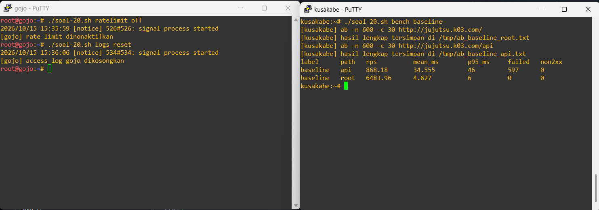

Nah untuk hasil lognya seperti ini:

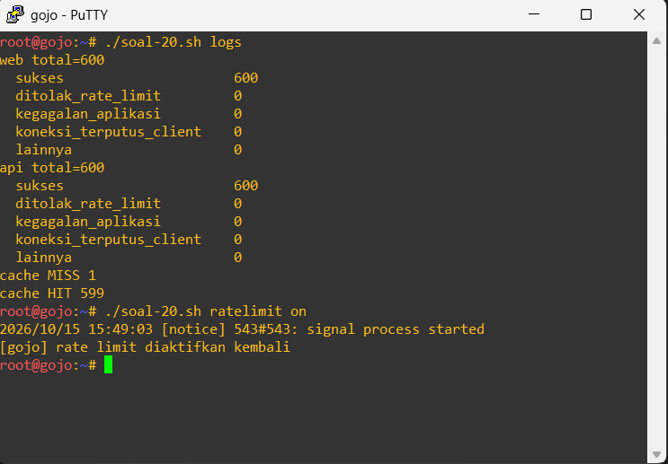

Nah kemudian hasil keduanya sebagai berikut:

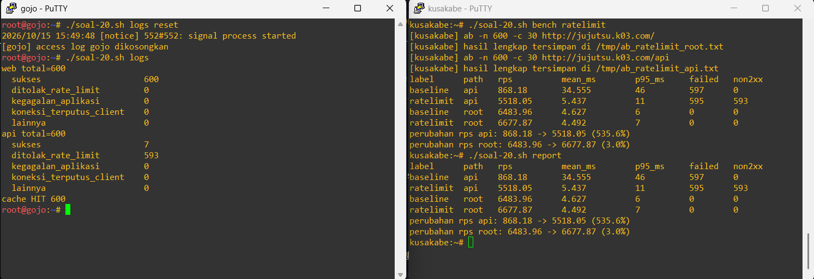

Seperti itu untuk urutannya sendiri seperti ini:

Gojo (`./soal-20.sh ratelimit off`) -> Gojo (`./soal-20.sh logs reset`) -> kusakabe (`./soal-20.sh bench baseline`) -> Gojo (`./soal-20.sh logs`) hasil pertama

Gojo (`./soal-20.sh ratelimit on`) -> Gojo (`./soal-20.sh logs reset`) -> kusakabe (`./soal-20.sh bench ratelimit`) -> Gojo (`./soal-20.sh logs`) -> kusakabe (`./soal-20.sh report`) hasil kedua

## Perbaikan

Ada 1 yang kurang di no 17 yaitu tidak ada client no 2 resultnya jadinya perlu ada pembaruan di script:

```sh
#!/bin/sh
set -eu

PREFIX="10.65"
NODE="$(hostname)"
ACTION="${1:-setup}"

DOMAIN="jujutsu.k03.com"
GOJO_IP="${PREFIX}.1.4"
GETO_IP="${PREFIX}.4.2"
DB_NAME="db_shibuya_k03"
SPOOF_IP="9.9.9.9"

GOJO_PROXY_SNIPPET="/etc/nginx/snippets/gojo-proxy.conf"
GETO_PROXY_SNIPPET="/etc/nginx/snippets/geto-proxy.conf"
GETO_REALIP_CONF="/etc/nginx/conf.d/geto-realip.conf"

log() {
    printf '[%s] %s\n' "$NODE" "$1"
}

die() {
    printf '[%s] ERROR: %s\n' "$NODE" "$1" >&2
    exit 1
}

require_root() {
    [ "$(id -u)" -eq 0 ] || die "script harus dijalankan sebagai root"
}

reload_nginx() {
    nginx -t >/dev/null 2>&1 || { nginx -t; die "konfigurasi nginx tidak valid"; }
    nginx -s reload || die "nginx gagal direload"
}

own_ip() {
    ip -4 -o addr show dev eth0 | awk '{print $4}' | cut -d/ -f1 | head -n 1
}

setup_gojo() {
    [ -d /etc/nginx/snippets ] || die "jalankan soal-16.sh di gojo terlebih dahulu"
    cat > "$GOJO_PROXY_SNIPPET" <<'EOF'
proxy_http_version 1.1;
proxy_set_header Connection "";
proxy_set_header Host $host;
proxy_set_header X-Real-IP $remote_addr;
proxy_set_header X-Forwarded-For $proxy_add_x_forwarded_for;
EOF
    reload_nginx
    log "gojo meneruskan X-Real-IP dan X-Forwarded-For"
}

setup_geto() {
    [ -d /etc/nginx/snippets ] || die "jalankan soal-15.sh di geto terlebih dahulu"

    cat > "$GETO_REALIP_CONF" <<EOF
set_real_ip_from ${GOJO_IP};
real_ip_header X-Forwarded-For;
real_ip_recursive on;

map \$http_x_forwarded_for \$geto_forwarded_for {
    default "\$http_x_forwarded_for, \$realip_remote_addr";
    "" \$realip_remote_addr;
}
EOF

    cat > "$GETO_PROXY_SNIPPET" <<'EOF'
proxy_http_version 1.1;
proxy_set_header Connection "";
proxy_set_header Host $host;
proxy_set_header X-Real-IP $remote_addr;
proxy_set_header X-Forwarded-For $geto_forwarded_for;
EOF
    reload_nginx
    log "geto hanya mempercayai alamat client dari proxy ${GOJO_IP}"
}

extract_ip() {
    printf '%s' "$1" | sed -n 's/.*"client_ip":"\([^"]*\)".*/\1/p'
}

report_match() {
    recorded="$(extract_ip "$3")"
    if [ -n "$2" ] && [ "$recorded" = "$2" ]; then
        verdict="sesuai"
    else
        verdict="TIDAK SESUAI"
    fi
    log "$1: ip_client=$2 tercatat=${recorded:-kosong} (${verdict})"
}

verify_client() {
    own="$(own_ip)"
    plain="$(curl -s -m 5 --resolve "${DOMAIN}:80:${GOJO_IP}" "http://${DOMAIN}/api" || true)"
    spoofed="$(curl -s -m 5 --resolve "${DOMAIN}:80:${GOJO_IP}" \
        -H "X-Forwarded-For: ${SPOOF_IP}" -H "X-Real-IP: ${SPOOF_IP}" \
        "http://${DOMAIN}/api" || true)" #letak penambahannya disini
    report_match "request normal via gojo" "$own" "$plain"
    report_match "request dengan header palsu via gojo" "$own" "$spoofed"
}

verify_spoof() {
    own="$(own_ip)"
    response="$(curl -s -m 5 -H "Host: ${DOMAIN}" \
        -H "X-Forwarded-For: ${SPOOF_IP}" -H "X-Real-IP: ${SPOOF_IP}" \
        "http://${GETO_IP}/api" || true)" # letak penambahannya disini
    report_match "akses langsung ke geto dengan header palsu" "$own" "$response"
}

show_db() {
    mariadb -e "SELECT id, worker, method, uri, client_ip, created_at FROM ${DB_NAME}.request_logs ORDER BY id DESC LIMIT 10"
}

case "$ACTION" in
    setup)
        require_root
        case "$NODE" in
            gojo) setup_gojo ;;
            geto) setup_geto ;;
            *) die "setup dijalankan di gojo dan geto" ;;
        esac
        ;;
    verify)
        verify_client
        ;;
    spoof)
        verify_spoof
        ;;
    db)
        show_db
        ;;
    *)
        die "penggunaan: soal-17.sh [setup|verify|spoof|db]"
        ;;
esac
```

Perbedaannya dengan script lama:

- `report_match`: ada penambahan `-n "$2"`
- penambahan `|| true` pada `verify_client` dan `verify_spoof`. Sudah saya kasih commentar dimana letaknya

Untuk hasilnya seperti berikut:

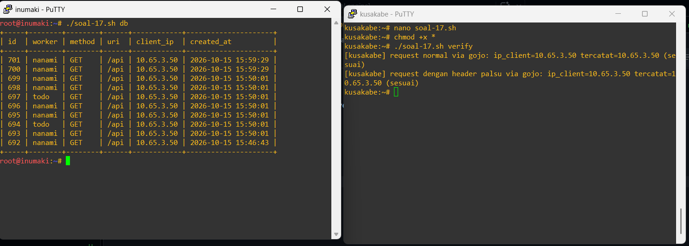

