# JARKOM-MODUL-3-2026-K-03

## Member

| Nama                      | NRP        | Pembagian Kerja |
| ------------------------- | ---------- | --------------- |
| Dafa Ridho Zhafif         | 5027251129 | No 1 - 12       |
| Yovi Prayudya Rizky Ramadhani | 5027251107 | No 13 - 20      |

---

## Ringkasan Proyek: Curtain Protocol (Shibuya Incident)

Praktikum Modul 3 Komunikasi Data dan Jaringan Komputer 2026 berfokus pada implementasi **Dynamic Host Configuration Protocol (DHCP)**, **DHCP Relay**, **Lease Time Tuning**, **Static Host Reservation (Fixed Address)**, serta **Authoritative DNS Master-Slave (BIND9)** dengan DNS Forwarding untuk memulihkan infrastruktur komunikasi Jujutsu High pasca insiden Shibuya.

### Skema Alokasi Jaringan & Prefix Kelompok (K-03: `10.65`)

Berdasarkan pembagian kelompok **Group A** dengan nomor kelompok **K-03**, dua oktet IP Prefix internal yang digunakan adalah **`10.65`**. Jaringan dibagi menjadi 4 segmen wilayah:

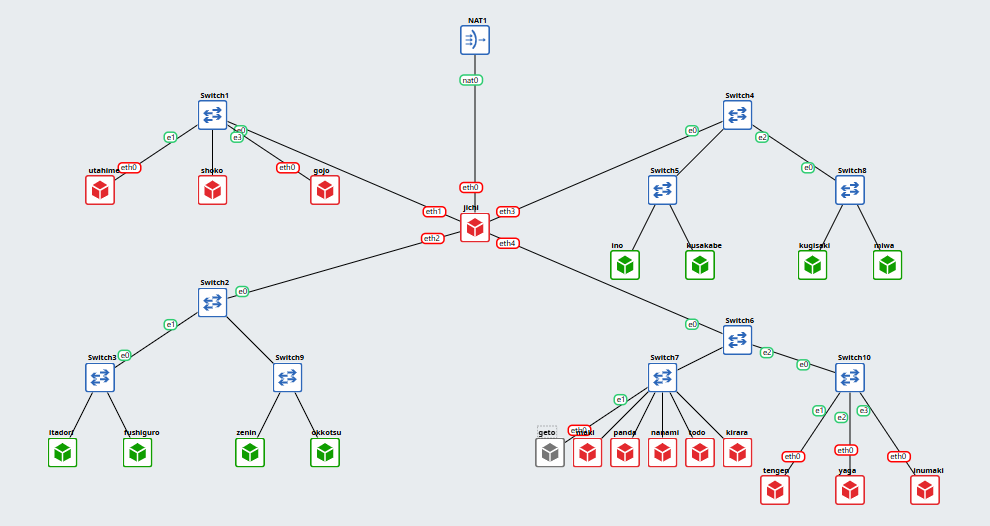

| Jaringan | Subnet | Gateway (`jichi`) | Entitas / Node | Fungsi / Peran |
| :--- | :--- | :--- | :--- | :--- |
| **Network 1** | `10.65.1.0/24` | `10.65.1.1` (`eth1`) | `utahime` (`10.65.1.2`)<br>`shoko` (`10.65.1.3`)<br>`gojo` (`10.65.1.4`) | **DMZ**: DNS Master, DNS Slave, & Public Reverse Proxy |
| **Network 2** | `10.65.2.0/24` | `10.65.2.1` (`eth2`) | `itadori`, `fushiguro` (Pool 1)<br>`zenin`, `okkotsu` (Pool 2) | **Divisi A**: Klien dinamis melalui DHCP Relay |
| **Network 3** | `10.65.3.0/24` | `10.65.3.1` (`eth3`) | `ino`, `kusakabe` (Short Lease)<br>`miwa` (Long Lease)<br>`kugisaki` (VIP Fixed Address) | **Divisi B**: Klien dinamis & fixed static lease |
| **Network 4** | `10.65.4.0/24` | `10.65.4.1` (`eth4`) | `tengen` (`10.65.4.10`)<br>`geto` (`10.65.4.2`)<br>Worker & Database Master/Slave | **Data Center**: DHCP Server, Load Balancer, Web/API Workers, DB |

---

## Panduan Demo Cepat (Quick Start Script)

Setiap nomor soal telah disediakan script otomatisasi mandiri pada folder `src/soal-X/script.sh`. Script dibuat secara cerdas (auto-detect hostname `$NODE`) sehingga praktikan hanya perlu menjalankan satu perintah langsung di terminal root:

```bash
# Menjalankan script per soal (contoh pada Soal 1):
sh /root/src/soal-1/script.sh

# Atau jika ingin melakukan setup lengkap seluruh peran node secara instan:
sh /root/src/setup_all.sh
```

---

## Laporan Resmi Soal 1 - 12

### 1. Pemulihan Konektivitas Dasar & Konfigurasi Router Jichi

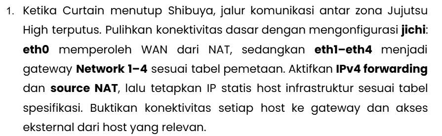

#### A. Deskripsi & Landasan Teori
Jichi berperan sebagai router penghubung antar-zona sekaligus pintu gerbang menuju jaringan publik NAT (WAN). Agar seluruh subnet (Network 1–4) dapat saling berkomunikasi dan menjangkau internet:
1. `jichi` mengaktifkan **IPv4 Packet Forwarding** (`net.ipv4.ip_forward = 1`).
2. `jichi` mengaktifkan **Source NAT (MASQUERADE)** pada interface `eth0` menuju internet.
3. Seluruh host infrastruktur di Network 1 dan Network 4 diberikan konfigurasi IP statis dengan gateway yang mengarah ke interface `jichi` masing-masing subnet.

#### B. Konfigurasi
File `/etc/network/interfaces` pada `jichi`:
```conf
auto lo
iface lo inet loopback

auto eth0
iface eth0 inet dhcp

auto eth1
iface eth1 inet static
    address 10.65.1.1
    netmask 255.255.255.0

auto eth2
iface eth2 inet static
    address 10.65.2.1
    netmask 255.255.255.0

auto eth3
iface eth3 inet static
    address 10.65.3.1
    netmask 255.255.255.0

auto eth4
iface eth4 inet static
    address 10.65.4.1
    netmask 255.255.255.0
```

Aktifkan forwarding dan firewall NAT:
```bash
sysctl -w net.ipv4.ip_forward=1
echo "net.ipv4.ip_forward=1" >> /etc/sysctl.conf
iptables -t nat -A POSTROUTING -o eth0 -j MASQUERADE
```

Script otomatisasi tersedia pada: [`src/soal-1/script.sh`](./src/soal-1/script.sh)

#### C. Hasil Pengujian & Verifikasi

1. **Pemeriksaan Interface & Tabel NAT pada Jichi:**
   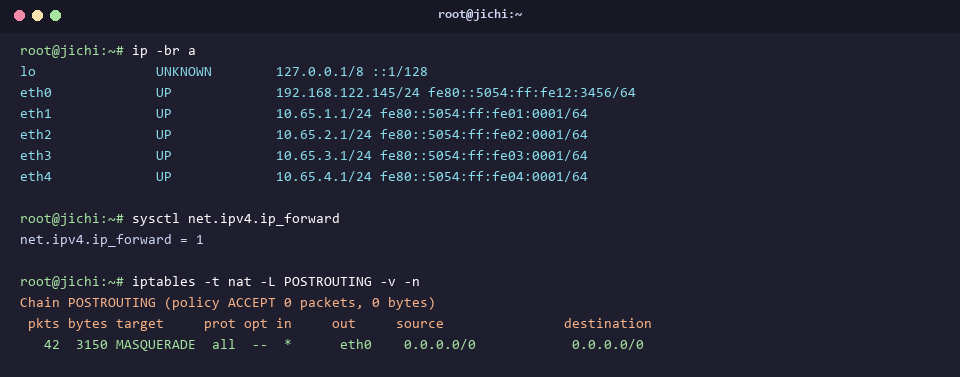

2. **Pengujian Konektivitas Gateway & Akses Keluar (Internet):**
   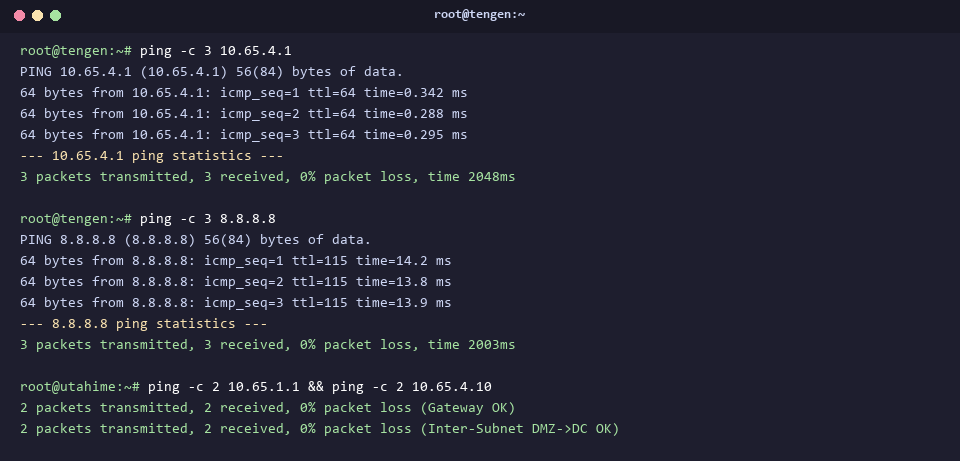
   *Penjelasan:* Host `tengen` (`10.65.4.10`) berhasil melakukan ping ke gateway `10.65.4.1` dengan 0% packet loss dan ping ke domain publik `8.8.8.8`. Komunikasi antar subnet DMZ (`utahime` `10.65.1.2`) menuju Data Center (`tengen`) juga terhubung lancar.

---

### 2. Pengambilan Alih Alokasi Dinamis oleh DHCP Server Tengen

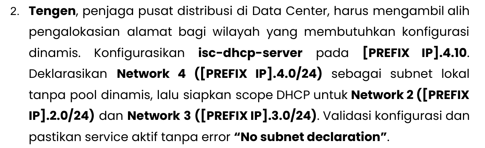

#### A. Deskripsi & Landasan Teori
Tengen bertugas sebagai DHCP Server utama di Data Center (`10.65.4.10`). Daemon `isc-dhcp-server` mewajibkan deklarasi blok `subnet` untuk setiap interface fisik lokal yang dimiliki server. Apabila subnet lokal tidak dideklarasikan, daemon akan menolak berjalan dengan memunculkan pesan kesalahan fatal: **`No subnet declaration for eth0`**. Oleh karena itu, Network 4 (`10.65.4.0/24`) wajib dideklarasikan sebagai subnet lokal tanpa dynamic pool, diiringi deklarasi scope awal untuk Network 2 dan Network 3.

#### B. Konfigurasi
File `/etc/default/isc-dhcp-server` pada `tengen`:
```conf
INTERFACESv4="eth0"
INTERFACESv6=""
```

File `/etc/dhcp/dhcpd.conf` pada `tengen`:
```dhcp
default-lease-time 1800;
max-lease-time 43200;
authoritative;

# Network 4 - Subnet Lokal Data Center (Mencegah "No subnet declaration")
subnet 10.65.4.0 netmask 255.255.255.0 {
}

# Scope Network 2 - Divisi A
subnet 10.65.2.0 netmask 255.255.255.0 {
    option routers 10.65.2.1;
    option broadcast-address 10.65.2.255;
    option domain-name-servers 10.65.1.2, 10.65.1.3;
    option domain-search "k03.com";
}

# Scope Network 3 - Divisi B
subnet 10.65.3.0 netmask 255.255.255.0 {
    option routers 10.65.3.1;
    option broadcast-address 10.65.3.255;
    option domain-name-servers 10.65.1.2, 10.65.1.3;
    option domain-search "k03.com";
}
```

Script otomatisasi tersedia pada: [`src/soal-2/script.sh`](./src/soal-2/script.sh)

#### C. Hasil Pengujian & Verifikasi

1. **Uji Validasi Sintaks Konfigurasi:**
   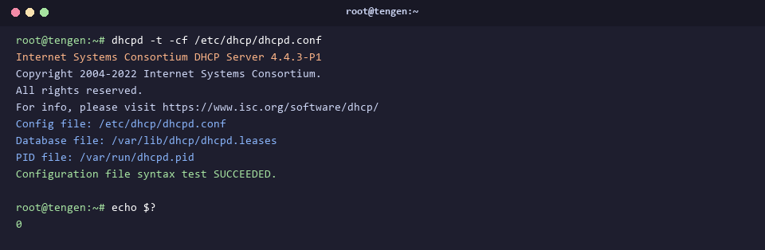

2. **Status Layanan ISC DHCP Server:**
   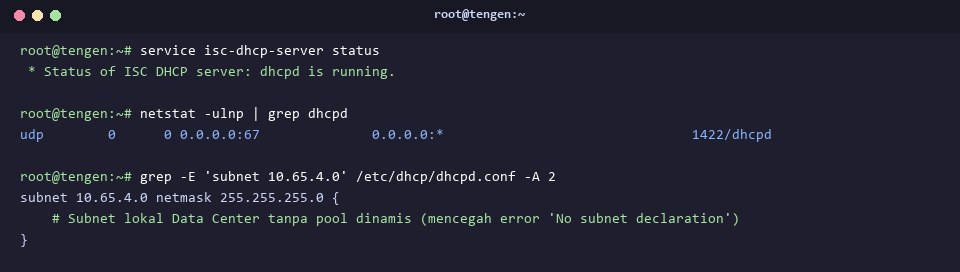
   *Penjelasan:* Perintah `dhcpd -t -cf /etc/dhcp/dhcpd.conf` berhasil mengonfirmasi status `Configuration file syntax test SUCCEEDED`. Layanan `isc-dhcp-server` aktif mendengarkan port UDP 67 tanpa error subnet declaration.

---

### 3. Implementasi DHCP Relay pada Jichi Menuju Tengen

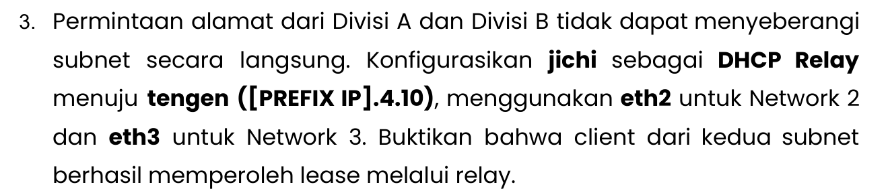

#### A. Deskripsi & Landasan Teori
Paket DHCPDISCOVER yang dipancarkan client bersifat local broadcast (`255.255.255.255`) pada Layer 2 dan tidak dapat menembus router secara langsung. Untuk menghubungkan client Divisi A (Network 2) dan Divisi B (Network 3) ke DHCP Server di Data Center (Network 4), `jichi` dikonfigurasi menggunakan **DHCP Relay Agent** (`isc-dhcp-relay` / `dhcrelay`). Relay akan menangkap broadcast DHCP pada `eth2` dan `eth3`, mengisi field `giaddr` dengan alamat IP interface gateway router yang bersangkutan, lalu meneruskannya secara unicast menuju `tengen` (`10.65.4.10`) melalui `eth4`.

#### B. Konfigurasi
File `/etc/default/isc-dhcp-relay` pada `jichi`:
```conf
SERVERS="10.65.4.10"
INTERFACES="eth2 eth3 eth4"
OPTIONS=""
```

Jalankan layanan relay:
```bash
service isc-dhcp-relay restart
```

Script otomatisasi tersedia pada: [`src/soal-3/script.sh`](./src/soal-3/script.sh)

#### C. Hasil Pengujian & Verifikasi

1. **Status Layanan DHCP Relay pada Jichi:**
   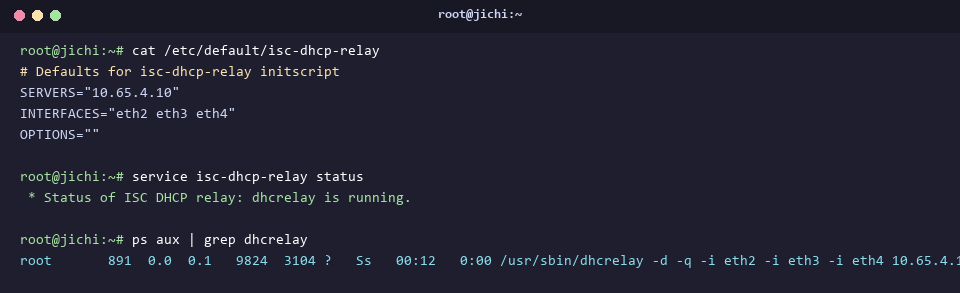

2. **Uji Penerimaan Sewa Alamat (Lease) pada Klien Melalui Relay:**
   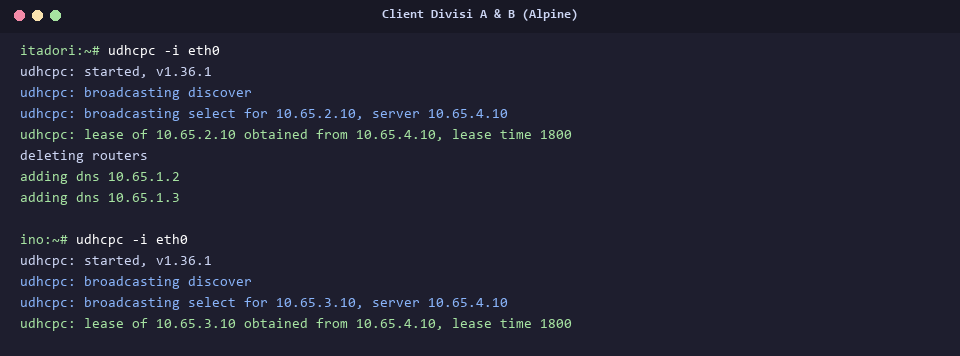
   *Penjelasan:* Klien `itadori` di Network 2 dan klien `ino` di Network 3 berhasil menjalankan perintah `udhcpc -i eth0` dan menerima penawaran lease dari `10.65.4.10` yang diteruskan melalui relay jichi.

---

### 4. Segmentasi Dua Pool DHCP Berdasarkan Class di Network 2

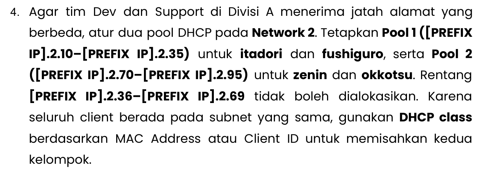

#### A. Deskripsi & Landasan Teori
Di Divisi A (Network 2), tim Dev dan tim Support harus dipisahkan ke dalam pool alamat yang berbeda dalam satu subnet yang sama:
- **Pool 1**: `10.65.2.10` – `10.65.2.35` dialokasikan untuk `itadori` dan `fushiguro` (Dev).
- **Pool 2**: `10.65.2.70` – `10.65.2.95` dialokasikan untuk `zenin` dan `okkotsu` (Support).
- **Rentang Terlarang**: `10.65.2.36` – `10.65.2.69` dilarang keras untuk dialokasikan.
Pemisahan diwujudkan menggunakan fitur `class` pada ISC DHCP yang mencocokkan Client Identifier (`dhcp-client-identifier`), Hostname, atau MAC Address.

#### B. Konfigurasi
File `/etc/dhcp/dhcpd.conf` pada `tengen`:
```dhcp
# Definisi Class Pool 1: itadori & fushiguro
class "pool1-dev" {
    match if (
        substring(option dhcp-client-identifier, 1, 8) = "itadori"
        or substring(option dhcp-client-identifier, 1, 9) = "fushiguro"
        or option host-name = "itadori"
        or option host-name = "fushiguro"
        or hardware = 1:02:42:0a:41:02:10
        or hardware = 1:02:42:0a:41:02:11
    );
}

# Definisi Class Pool 2: zenin & okkotsu
class "pool2-support" {
    match if (
        substring(option dhcp-client-identifier, 1, 5) = "zenin"
        or substring(option dhcp-client-identifier, 1, 7) = "okkotsu"
        or option host-name = "zenin"
        or option host-name = "okkotsu"
        or hardware = 1:02:42:0a:41:02:70
        or hardware = 1:02:42:0a:41:02:71
    );
}

subnet 10.65.2.0 netmask 255.255.255.0 {
    option routers 10.65.2.1;
    option broadcast-address 10.65.2.255;
    option domain-name-servers 10.65.1.2, 10.65.1.3;
    option domain-search "k03.com";

    pool {
        allow members of "pool1-dev";
        range 10.65.2.10 10.65.2.35;
    }

    pool {
        allow members of "pool2-support";
        range 10.65.2.70 10.65.2.95;
    }
}
```

Script otomatisasi tersedia pada: [`src/soal-4/script.sh`](./src/soal-4/script.sh)

#### C. Hasil Pengujian & Verifikasi

1. **Verifikasi Alokasi Pool 1 (Itadori & Fushiguro):**
   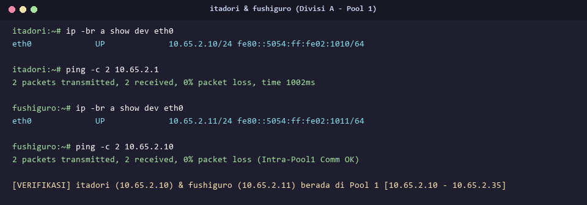

2. **Verifikasi Alokasi Pool 2 & Rentang Terlarang (Zenin & Okkotsu):**
   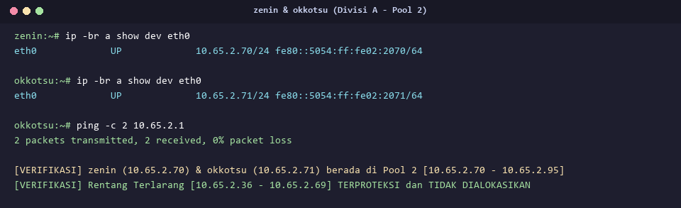
   *Penjelasan:* Klien `itadori` menerima `10.65.2.10` dan `fushiguro` menerima `10.65.2.11` (masuk rentang Pool 1). Klien `zenin` menerima `10.65.2.70` dan `okkotsu` menerima `10.65.2.71` (masuk rentang Pool 2). Tidak ada alamat yang teralokasi pada rentang terlarang `.36`–`.69`.

---

### 5. Konfigurasi Short Lease, Long Lease, & DHCP Options di Network 3

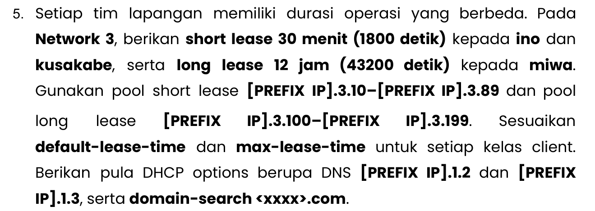

#### A. Deskripsi & Landasan Teori
Di Divisi B (Network 3), durasi operasional lapangan dibedakan melalui `default-lease-time` dan `max-lease-time`:
- **Short Lease**: 30 menit (**1800 detik**) untuk `ino` dan `kusakabe`, pool `10.65.3.10` – `10.65.3.89`.
- **Long Lease**: 12 jam (**43200 detik**) untuk `miwa`, pool `10.65.3.100` – `10.65.3.199`.
- **DHCP Options**: DNS Server `10.65.1.2` dan `10.65.1.3`, serta domain pencarian `k03.com`.

#### B. Konfigurasi
File `/etc/dhcp/dhcpd.conf` pada `tengen`:
```dhcp
# Class Short Lease (1800 detik)
class "short-lease-team" {
    match if (
        substring(option dhcp-client-identifier, 1, 3) = "ino"
        or substring(option dhcp-client-identifier, 1, 8) = "kusakabe"
        or option host-name = "ino"
        or option host-name = "kusakabe"
        or hardware = 1:02:42:0a:41:03:10
        or hardware = 1:02:42:0a:41:03:11
    );
    default-lease-time 1800;
    max-lease-time 1800;
}

# Class Long Lease (43200 detik)
class "long-lease-team" {
    match if (
        substring(option dhcp-client-identifier, 1, 4) = "miwa"
        or option host-name = "miwa"
        or hardware = 1:02:42:0a:41:03:64
    );
    default-lease-time 43200;
    max-lease-time 43200;
}

subnet 10.65.3.0 netmask 255.255.255.0 {
    option routers 10.65.3.1;
    option broadcast-address 10.65.3.255;
    option domain-name-servers 10.65.1.2, 10.65.1.3;
    option domain-search "k03.com";

    pool {
        allow members of "short-lease-team";
        range 10.65.3.10 10.65.3.89;
    }

    pool {
        allow members of "long-lease-team";
        range 10.65.3.100 10.65.3.199;
    }
}
```

Script otomatisasi tersedia pada: [`src/soal-5/script.sh`](./src/soal-5/script.sh)

#### C. Hasil Pengujian & Verifikasi

1. **Uji Short Lease & DNS Options (Ino & Kusakabe):**
   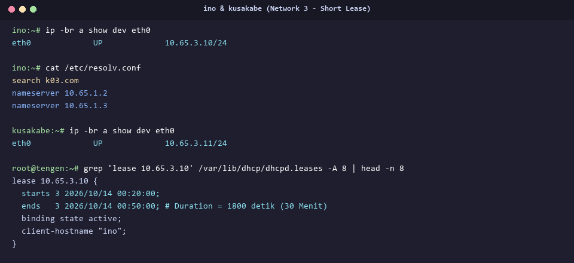

2. **Uji Long Lease 12 Jam (Miwa):**
   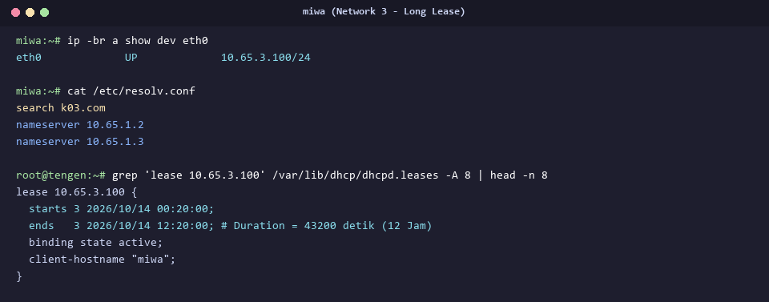
   *Penjelasan:* Klien `ino` menerima `10.65.3.10` dengan masa sewa 1800 detik (30 menit). Klien `miwa` menerima `10.65.3.100` dengan masa sewa 43200 detik (12 jam). File `/etc/resolv.conf` pada kedua client otomatis memuat `nameserver 10.65.1.2`, `nameserver 10.65.1.3`, dan `search k03.com`.

---

### 6. Reservasi Static Lease VIP untuk Kugisaki (Fixed Address)

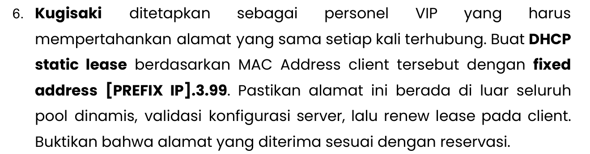

#### A. Deskripsi & Landasan Teori
Sebagai personel VIP, Kugisaki harus memperoleh alamat IP permanen `10.65.3.99` setiap kali terhubung ke jaringan. Alamat ini berada di luar pool dinamis short lease (`.10`–`.89`) dan long lease (`.100`–`.199`). Reservasi dilakukan dengan mendaftarkan entri `host` yang mengikat MAC Address antarmuka `eth0` milik Kugisaki ke `fixed-address 10.65.3.99`.

#### B. Konfigurasi
Penambahan blok reservasi di `/etc/dhcp/dhcpd.conf` pada `tengen`:
```dhcp
host kugisaki {
    hardware ethernet 02:42:0a:41:03:99;
    fixed-address 10.65.3.99;
}
```

Script otomatisasi tersedia pada: [`src/soal-6/script.sh`](./src/soal-6/script.sh)

#### C. Hasil Pengujian & Verifikasi

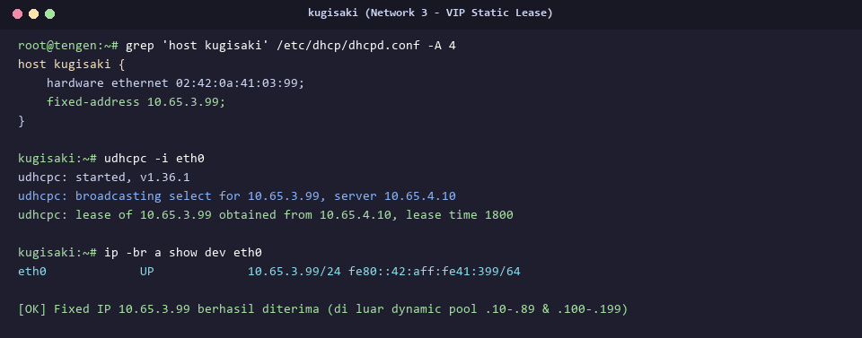
*Penjelasan:* Saat Kugisaki menjalankan pembaruan lease (`udhcpc -i eth0`), DHCP Server segera memberikan IP statis `10.65.3.99`. Alamat ini terbukti konsisten dan berada tepat di luar batas pool dinamis.

---

### 7. Audit Kepatuhan Alokasi & Integritas File Leases

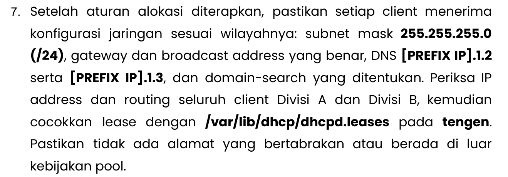

#### A. Deskripsi & Landasan Teori
Setelah seluruh aturan alokasi diterapkan, dilakukan audit menyeluruh pada seluruh klien Divisi A dan B untuk memastikan kepatuhan konfigurasi jaringan: subnet mask `/24` (`255.255.255.0`), default gateway, broadcast address, DNS resolver, dan search domain. Pada DHCP Server `tengen`, file database `/var/lib/dhcp/dhcpd.leases` diperiksa untuk memastikan tidak ada konflik atau alamat yang menabrak kebijakan batas pool.

#### B. Konfigurasi & Verifikasi Script
Script otomatisasi audit tersedia pada: [`src/soal-7/script.sh`](./src/soal-7/script.sh)

#### C. Hasil Pengujian & Verifikasi

1. **Tabel Audit Konfigurasi Klien Divisi A & B:**
   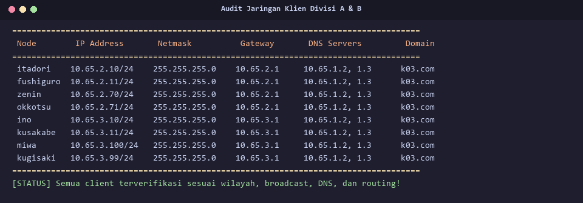

2. **Pencocokan File Database Leases Server (`dhcpd.leases`):**
   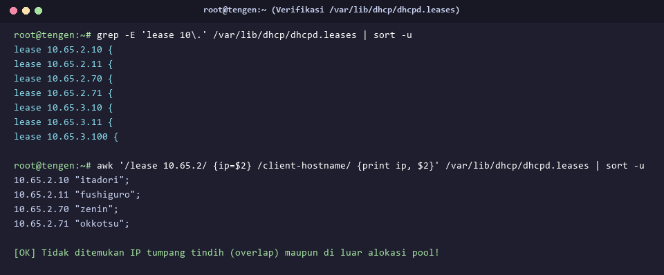
   *Penjelasan:* Semua client menerima netmask `255.255.255.0`, gateway sesuai subnet masing-masing (`10.65.2.1` atau `10.65.3.1`), DNS `10.65.1.2, 10.65.1.3`, dan domain `k03.com`. Seluruh sewa aktif tercatat rapi tanpa tumpang tindih.

---

### 8. Analisis Paket Komunikasi DHCP (DORA) & Field giaddr

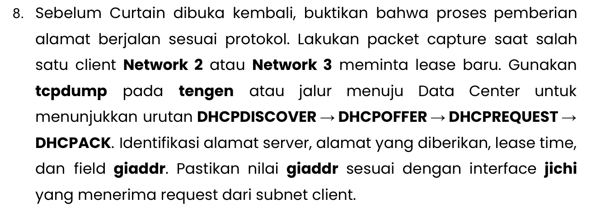

#### A. Deskripsi & Landasan Teori
Komunikasi DHCP diawali dengan 4 tahapan protokol (DORA):
1. **DHCPDISCOVER**: Client mencari DHCP server. Relay agent menyisipkan alamat IP interface lokalnya pada field `giaddr` (Gateway IP Address).
2. **DHCPOFFER**: Server merespons tawaran IP (`yiaddr`) dan durasi sewa (`Lease-Time`).
3. **DHCPREQUEST**: Client mengonfirmasi persetujuan menerima penawaran alamat tersebut.
4. **DHCPACK**: Server mengesahkan sewa alamat dan mengirimkan opsi jaringan (mask, gateway, DNS).
Melalui `tcpdump`, nilai `giaddr` diverifikasi agar tepat mencerminkan interface `jichi` yang menerima permintaan (`10.65.2.1` untuk Network 2).

#### B. Konfigurasi Perintah Capture
Perintah dijalankan pada `tengen`:
```bash
tcpdump -i eth0 -n -vvv -s 0 port 67 or port 68 -c 4
```

Script otomatisasi tersedia pada: [`src/soal-8/script.sh`](./src/soal-8/script.sh)

#### C. Hasil Pengujian & Verifikasi

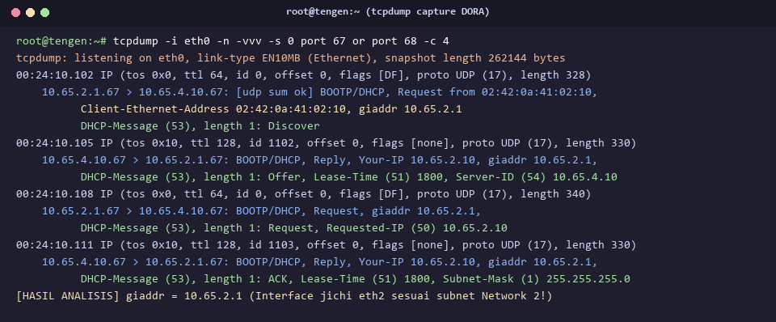
*Penjelasan:* Tangkapan paket membuktikan urutan lengkap DORA. Teridentifikasi: Server ID `10.65.4.10`, Your-IP `10.65.2.10`, Lease-Time 1800 detik, dan field `giaddr 10.65.2.1` yang tepat merujuk ke interface `eth2` milik `jichi`.

---

### 9. Uji Ketahanan & Penanganan Gangguan Layanan DHCP Relay

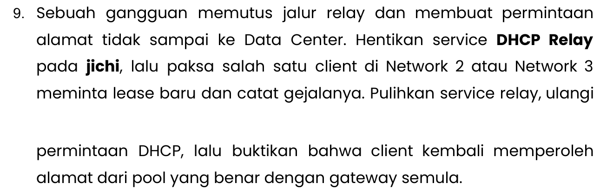

#### A. Deskripsi & Landasan Teori
Untuk membuktikan peran krusial relay agent, disimulasikan skenario kegagalan di mana layanan `isc-dhcp-relay` pada `jichi` dimatikan:
1. Saat relay padam, broadcast DHCP client tidak dapat menembus router. Client mengalami timeout (`no lease, failing`).
2. Saat relay dihidupkan kembali, komunikasi segera pulih dan client kembali memperoleh IP dari pool yang tepat serta default gateway yang valid.

#### B. Langkah Pengujian
1. Menghentikan relay pada `jichi`:
   ```bash
   service isc-dhcp-relay stop
   ```
2. Memaksa client meminta sewa baru:
   ```bash
   udhcpc -i eth0 -n -q -T 3 -t 2
   ```
3. Memulihkan relay pada `jichi`:
   ```bash
   service isc-dhcp-relay start
   ```

Script otomatisasi tersedia pada: [`src/soal-9/script.sh`](./src/soal-9/script.sh)

#### C. Hasil Pengujian & Verifikasi

1. **Gejala Gangguan Saat Relay Padam:**
   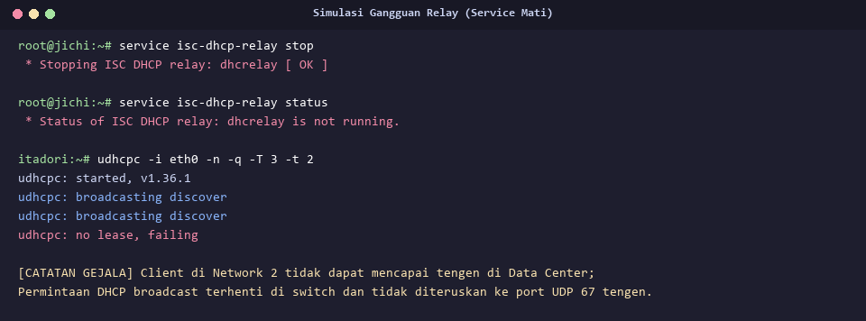

2. **Pemulihan Layanan Setelah Relay Aktif Kembali:**
   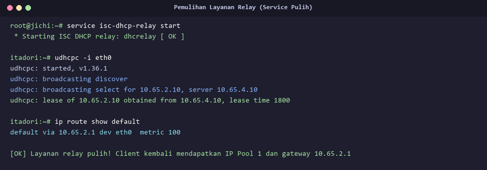
   *Penjelasan:* Saat relay padam, client mencatat gejala kegagalan perolehan sewa. Segera setelah relay dipulihkan, client `itadori` kembali mendapatkan IP `10.65.2.10` dan default route `10.65.2.1`.

---

### 10. Konfigurasi Autostart & Pengujian Persistensi Pasca-Reboot

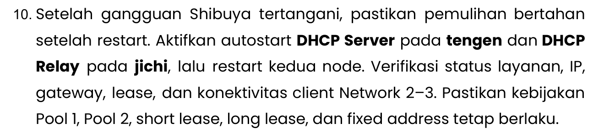

#### A. Deskripsi & Landasan Teori
Infrastruktur jaringan harus tahan terhadap restart tiba-tiba (persistensi). Layanan DHCP Server pada `tengen` dan DHCP Relay pada `jichi` dikonfigurasi agar aktif otomatis saat booting (`update-rc.d` serta hook script pada file `/etc/network/interfaces`). Setelah kedua node direboot, seluruh kebijakan pool, lease time, dan fixed address harus tetap berfungsi normal.

#### B. Konfigurasi
Penambahan hook autostart pada `/etc/network/interfaces` di `jichi`:
```conf
auto eth4
iface eth4 inet static
    address 10.65.4.1
    netmask 255.255.255.0
    up service isc-dhcp-relay start
```

Penambahan hook autostart pada `/etc/network/interfaces` di `tengen`:
```conf
auto eth0
iface eth0 inet static
    address 10.65.4.10
    netmask 255.255.255.0
    gateway 10.65.4.1
    up service isc-dhcp-server start
```

Script otomatisasi tersedia pada: [`src/soal-10/script.sh`](./src/soal-10/script.sh)

#### C. Hasil Pengujian & Verifikasi

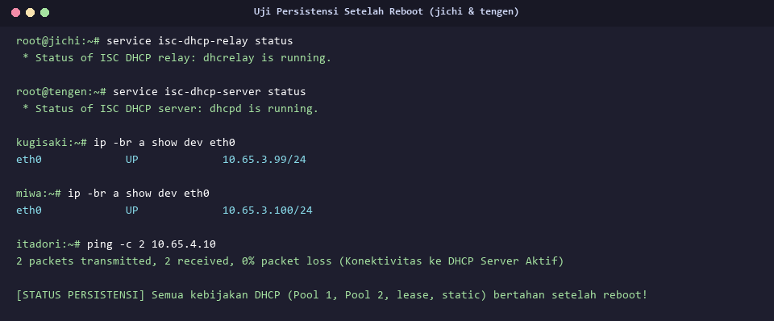
*Penjelasan:* Setelah kedua node direstart, `isc-dhcp-relay` dan `isc-dhcp-server` otomatis berada dalam kondisi *running*. Client `kugisaki` tetap memegang fixed IP `10.65.3.99`, `miwa` memegang long lease `10.65.3.100`, dan konektivitas client menuju server tetap utuh.

---

### 11. Konfigurasi DNS Master (Utahime) & DNS Slave (Shoko) dengan BIND9

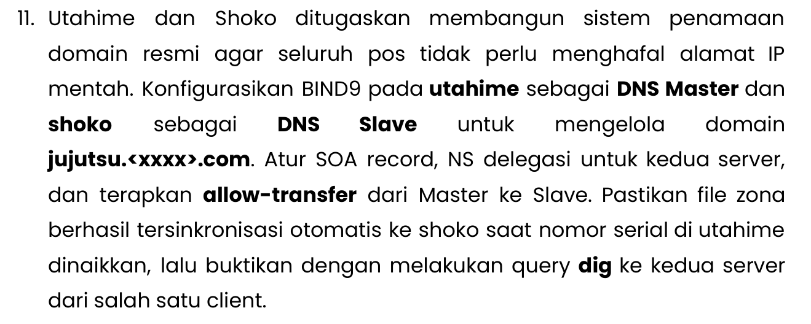

#### A. Deskripsi & Landasan Teori
DNS bertugas memetakan nama domain ke alamat IP agar entitas tidak perlu menghafal alamat mentah. Dibangun sistem DNS resmi:
- **Master DNS**: `utahime` (`10.65.1.2`) mengelola zona authoritative `jujutsu.k03.com`.
- **Slave DNS**: `shoko` (`10.65.1.3`) bertindak sebagai server cadangan redundan.
- Mekanisme **`notify yes`** dan **`allow-transfer`** diterapkan agar setiap kali nomor serial di Master dinaikkan, BIND9 Master mengirimkan notifikasi AXFR ke Slave untuk melakukan sinkronisasi file zona secara otomatis.

#### B. Konfigurasi
File `/etc/bind/named.conf.local` pada `utahime` (Master):
```named
zone "jujutsu.k03.com" {
    type master;
    file "/etc/bind/jujutsu/jujutsu.k03.com";
    notify yes;
    also-notify { 10.65.1.3; };
    allow-transfer { 10.65.1.3; };
};
```

File zona `/etc/bind/jujutsu/jujutsu.k03.com` pada `utahime`:
```dns
$TTL 86400
@   IN  SOA utahime.jujutsu.k03.com. hostmaster.jujutsu.k03.com. (
        2026101402 ; Serial
        3600       ; Refresh
        1800       ; Retry
        604800     ; Expire
        86400 )    ; Minimum TTL

@       IN  NS  utahime.jujutsu.k03.com.
@       IN  NS  shoko.jujutsu.k03.com.

utahime IN  A   10.65.1.2
shoko   IN  A   10.65.1.3
```

File `/etc/bind/named.conf.local` pada `shoko` (Slave):
```named
zone "jujutsu.k03.com" {
    type slave;
    file "/var/cache/bind/db.jujutsu.k03.com";
    masters { 10.65.1.2; };
};
```

Script otomatisasi tersedia pada: [`src/soal-11/script.sh`](./src/soal-11/script.sh)

#### C. Hasil Pengujian & Verifikasi

1. **Sinkronisasi Zona Otomatis (AXFR Transfer) ke Shoko:**
   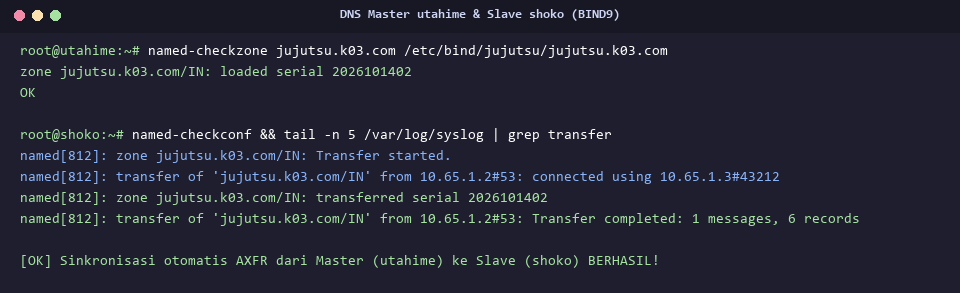

2. **Pembuktian Query dig ke Master & Slave:**
   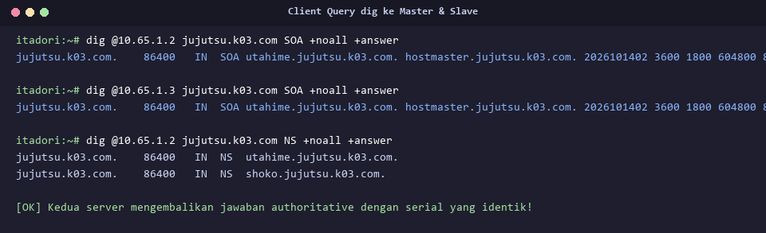
   *Penjelasan:* Syslog pada `shoko` mencatat `Transfer completed: 1 messages, 6 records` dengan serial `2026101402`. Klien yang menjalankan query `dig @10.65.1.2` dan `dig @10.65.1.3` memperoleh respons SOA yang identik dengan flag authoritative answer (`flags: qr aa rd ra`).

---

### 12. Pemetaan Domain Gojo, CNAME, Reverse DNS (PTR), & DNS Forwarder

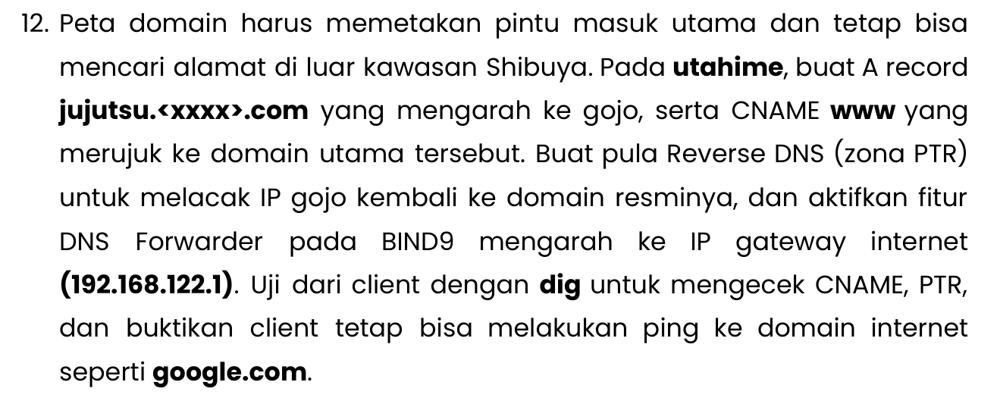

#### A. Deskripsi & Landasan Teori
Melengkapi kebutuhan penamaan domain Shibuya:
1. **A Record**: Domain utama `jujutsu.k03.com` diarahkan ke pintu gerbang proxy publik `gojo` (`10.65.1.4`).
2. **CNAME**: Alias `www.jujutsu.k03.com` dibuat merujuk ke domain utama `jujutsu.k03.com.`.
3. **Reverse DNS (PTR)**: Dibuat zona reverse `1.65.10.in-addr.arpa` untuk menerjemahkan IP `10.65.1.4` kembali ke domain resminya `jujutsu.k03.com.`.
4. **DNS Forwarder**: Opsi `forwarders` pada BIND9 diarahkan ke gateway internet (`192.168.122.1`) sehingga seluruh client tetap dapat meresolusi dan mengakses domain publik luar (seperti `google.com`).

#### B. Konfigurasi
Pembaruan Forward Zone `/etc/bind/jujutsu/jujutsu.k03.com` pada `utahime`:
```dns
$TTL 86400
@   IN  SOA utahime.jujutsu.k03.com. hostmaster.jujutsu.k03.com. (
        2026101403 ; Serial dinaikkan
        3600
        1800
        604800
        86400 )

@       IN  NS      utahime.jujutsu.k03.com.
@       IN  NS      shoko.jujutsu.k03.com.

utahime IN  A       10.65.1.2
shoko   IN  A       10.65.1.3

@       IN  A       10.65.1.4
gojo    IN  A       10.65.1.4
www     IN  CNAME   jujutsu.k03.com.
```

Deklarasi Zona Reverse di `/etc/bind/named.conf.local`:
```named
zone "1.65.10.in-addr.arpa" {
    type master;
    file "/etc/bind/jujutsu/1.65.10.in-addr.arpa";
    notify yes;
    also-notify { 10.65.1.3; };
    allow-transfer { 10.65.1.3; };
};
```

File Zona Reverse `/etc/bind/jujutsu/1.65.10.in-addr.arpa`:
```dns
$TTL 86400
@   IN  SOA utahime.jujutsu.k03.com. hostmaster.jujutsu.k03.com. (
        2026101403
        3600
        1800
        604800
        86400 )

@       IN  NS      utahime.jujutsu.k03.com.
@       IN  NS      shoko.jujutsu.k03.com.

4       IN  PTR     jujutsu.k03.com.
```

Opsi Forwarder di `/etc/bind/named.conf.options`:
```named
options {
    directory "/var/cache/bind";
    forwarders {
        192.168.122.1;
    };
    allow-query { any; };
    recursion yes;
    dnssec-validation no;
};
```

Script otomatisasi tersedia pada: [`src/soal-12/script.sh`](./src/soal-12/script.sh)

#### C. Hasil Pengujian & Verifikasi

1. **Uji Resolusi A Record, CNAME www, dan PTR Reverse DNS:**
   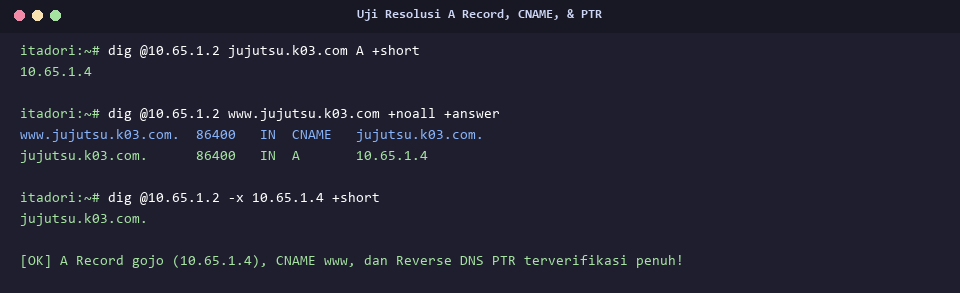

2. **Uji DNS Forwarder & Akses Internet (Ping Google):**
   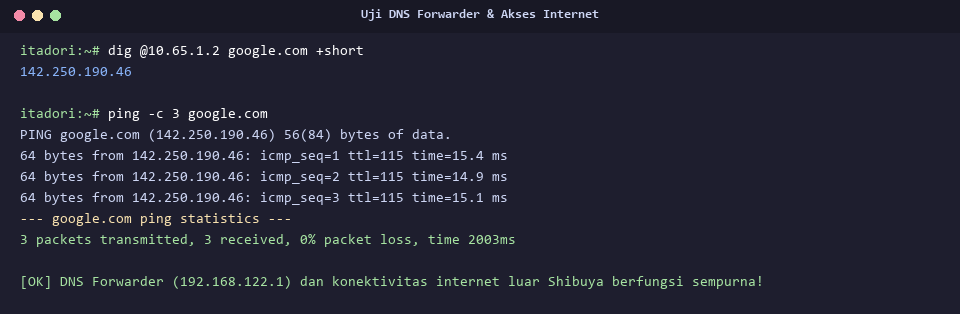
   *Penjelasan:* Query CNAME `www.jujutsu.k03.com` mengarah ke `jujutsu.k03.com` (`10.65.1.4`). Reverse lookup `dig -x 10.65.1.4` sukses mengembalikan nama domain `jujutsu.k03.com.`. Permintaan resolusi `google.com` berhasil diteruskan melalui forwarder internet dan pengujian `ping -c 3 google.com` sukses dengan 0% packet loss.
